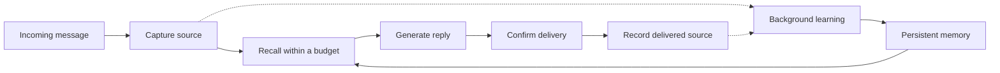

# memBrain

**A human-inspired memory engine for AI agents.**

English | [简体中文](README.zh-CN.md)

memBrain was previously named Agent Memory. Existing installations, data directories and `agent_memory` imports keep working.

Help your agent carry useful memories across conversations—with layered recall, selective forgetting, and traceable sources.

memBrain runs as a local service. Connect your agent's conversation lifecycle once, and the runtime captures messages, prepares relevant memory before replies, and learns in the background. The agent keeps the same brain across process restarts and changes to its configured reply model.

[Claude Code plugin](#claude-code-plugin) · [Why memBrain](#why-membrain) · [Quickstart](#quickstart) · [Python integration](#python-integration) · [How memory works](#how-memory-works) · [Status and verification](#status-and-verification) · [Full reference](docs/reference.md)

> **Pre-release.** The synchronous text runtime is implemented; long-term memory quality is still being validated. The Claude Code plugin and the Docker-free embedded database are new and verified on Linux x86_64 only. Desktop installation with Docker is verified on macOS. See [supported scope and known limits](#status-and-verification).

<a id="claude-code-plugin"></a>

## Use with Claude Code

Tell your agent:

> Install the memBrain plugin: `claude plugin install membrain --marketplace chriswu727/membrain`

Inside a Claude Code session you can also run `/plugin install membrain --marketplace chriswu727/membrain`. The only prerequisite is [uv](https://docs.astral.sh/uv/). There is no Docker, setup wizard or extra model API key.

From the next session on, the plugin:

- records each message and Claude's final reply locally;
- starts each session with the user's complete earlier history while it is small, and switches to recalling matching records before each reply once it grows;
- gives Claude memory tools for deliberate searches, short notes and user-requested deletion.

The first session installs the runtime and an embedded PostgreSQL database in the background; messages sent before it is ready are queued and stored afterwards. Automatic recall matches words in the current message, and Claude is instructed to search with concrete keywords when personal context matters. Model-driven background learning stays off unless you configure a provider. Memory lives in your user data directory (for example `~/.local/share/membrain` on Linux) and is shared by your sessions. See [plugin mode](architecture/plugin-mode.md) for the design, verification and limits.

Other MCP hosts can add a stdio server that runs `uvx --python 3.12 --from "membrain-ai[embedded] @ git+https://github.com/chriswu727/membrain" membrain plugin mcp`. That provides the memory tools without automatic recording.

<a id="why-membrain"></a>

## Why memBrain

- **Traceable, not rewritten.** Every memory keeps who said it and when. Recalled context is labelled as historical data, so a model can tell what you said from what it once suggested.
- **Local and private.** One command installs an embedded database on your machine. There is no Docker, cloud account or extra model key; the host model you already use does the interpretation.
- **Never in the way.** Hooks fail open: if memory is unavailable, your agent answers as usual and records are queued until it recovers.
- **Forgetting you can audit.** Erasure is recorded and survives restoring an older backup.
- **Measured in the open.** Evaluations, including failed ones, are published with their method and cost. Personality and emotion modelling are planned research, not current features.

<a id="desktop-setup"></a>

## Quickstart

Install [uv](https://docs.astral.sh/uv/). You will need a Chat Completions-compatible model endpoint, model name, and API key; memory learning also requires JSON mode.

```sh
uv tool install --python 3.12 'membrain-ai[embedded] @ https://github.com/chriswu727/membrain/archive/refs/heads/main.zip'
membrain desktop setup
membrain desktop configure-chat --use-cognition
membrain desktop chat
```

During `setup`, enter the provider details for memory learning. `configure-chat --use-cognition` explicitly reuses that configuration for replies. To use a different reply model, run `membrain desktop configure-chat` without the flag.

Setup creates a persistent brain and starts its database, API, and background worker. With the `embedded` extra on macOS, Windows or Linux x86_64 and Python 3.12, the database runs as an embedded PostgreSQL without Docker; elsewhere setup uses Docker Desktop (`--database docker|embedded` overrides the choice). You do not need to clone the repository or start these services separately. If the installed command is missing from your shell, run `uv tool update-shell` and reopen the terminal.

**Storage is local; model processing follows your provider configuration.** Chat and semantic learning can incur API charges and send relevant content to that provider. Skipping cognition setup leaves storage and lexical recall available, but disables model-driven learning. Slow reasoning models may need the explicit [reasoning preset and provider controls](docs/reference.md#desktop-setup).

### Try continuity across conversations

Start with an ordinary task, such as:

> I'm drafting a short story. Half-hour writing sessions work best for me.

Continue the conversation, then enter `/quit`. Check background learning and open another conversation in the same installation:

```sh
membrain desktop learning-status
membrain desktop chat --conversation writing-followup
```

Ask for help planning the next writing session. This lets you explore whether earlier feedback helps with a new request, without manually calling a save or search tool. A new conversation reuses the same brain; it is not a separate user's privacy boundary. If learning is pending or blocked, inspect its status before interpreting the result.

This is a suggested hands-on exercise, not a prerecorded result or a guarantee of recall. A [bounded real-model diagnostic](evaluations/v1-2026-10-25-preference-use.md) records a related successful use of a half-hour preference alongside remaining answer-quality defects.

<a id="automatic-integration"></a>

## Python integration

After desktop setup and chat configuration, install the package in your application's Python 3.12+ environment too. Run this from a project with an active virtual environment or a `.venv` directory. The CLI's isolated environment does not make the SDK importable in your application.

```sh
uv pip install 'membrain @ https://github.com/chriswu727/membrain/archive/refs/heads/main.zip'
```

The following terminal example uses your saved model configuration and persistent brain:

```python
from membrain.agent_session import open_agent
from membrain.runtime import DeliveryReceipt


def deliver(request):
    print(request.text, flush=True)
    return DeliveryReceipt("delivered")


with open_agent(conversation_id="writing", deliver=deliver) as agent:
    agent.respond(
        "Help me plan my next writing session.",
        message_id="writing-request-001",
    )
```

Run this in a Python 3.12+ environment. In a real host, replace `deliver` with the actual sending operation and return success only when sending is confirmed. The example confirms a terminal write, not that a person read the answer. Give each new incoming message a stable unique ID and reuse that ID only when reconciling the same message. Replaying a completed message does not generate or deliver another response.

For your own model callback, delivery channel, recovery handling, or optional answer reviewer, see the [automatic integration reference](docs/reference.md#automatic-integration). HTTP and TypeScript clients expose the underlying operations; the ready-made automatic text runtime is currently Python.

<a id="mcp"></a>

## Connect through MCP

After setup, generate the configuration for a stdio MCP host:

```sh
membrain desktop mcp-config
```

Add the generated configuration to your host. The bridge starts or connects to the same local service and exposes memory tools.

**MCP is currently `tools_only`.** It does not intercept every conversation, confirm delivery, or take over compaction. Automatic capture and pre-answer recall require lifecycle integration through the Python runtime or a host adapter. Dedicated QQ/framework plugins and an OpenAI-compatible memory gateway have not been delivered. [MCP reference](docs/reference.md#mcp).

## How memory works

“Human-inspired” describes the design direction: different forms of memory, changing accessibility, cue-based recall, and learning from new evidence. Biological equivalence and human-level reliability have not been established.



| Mechanism | What the runtime does |
| --- | --- |
| Working and long-term memory | Combines bounded recent context with persistent episodic, semantic, and procedural representations. |
| Selective forgetting | Adjusts accessibility using age, representation, retention priority, and recorded use. Important memories can be protected. Lower accessibility is separate from deleting data. |
| Detail on demand | Can present a verified short expression of an older memory and expand full detail for specific cues or explicit inspection. Original records remain stored; optional summaries are selected by the configured model. |
| Cue-based recall | Uses lexical retrieval, optional semantic embeddings, and bounded contextual links to find candidates. Relevant short replies can be reached through adjacent sources. |
| Revision and uncertainty | Keeps source versions, conditions, conflicts, and applicability labels so new information can qualify older memories. |
| Traceable learning | Retains supporting source references and checks proposed memories before publication. Model judgments remain fallible. |
| Persistent identity | Keeps the brain separate from the reply model and process, with explicit scope, restart, and recovery handling. |

The current context still has a limit. The runtime selects memory within that budget; long-term state is stored separately from the current model prompt. Detailed behavior is documented in the [architecture](architecture/architecture.html), [retrieval design](architecture/conversation-retrieval.md), and [runtime reference](docs/reference.md).

[Source-preserving recall resolution](architecture/recall-resolution.md) explains encoding, cue expansion and upgrade compatibility. Existing memories without a verified short expression keep their full view; an upgrade does not run a paid rewrite of the archive.

[Source-faithful composition](architecture/source-composition.md) separates factual details from writing style and requires participant-action checks for new claims, short views and episodes. New assistant speech memories retain source quotations with unresolved embedded voices; publication recomputes those views instead of trusting a paraphrase. User-reported facts still support semantic encoding and verified short expressions. Bounded original-source context can retain a scene together with its expressed meaning. Host instructions and model assessments remain fallible; installing memory tools alone cannot enforce an arbitrary agent's writing behavior.

## Local operation

```sh
membrain desktop status
membrain desktop logs
membrain desktop learning-status
membrain desktop stop
membrain desktop start
```

Stopping the service retains committed memories. The next chat, MCP, or SDK connection can start it again. Configuration lives in the installation directory; memory content lives in its Docker database volume. Copying the configuration directory alone is not a database backup.

See [updating and configuration](docs/reference.md#local-status-and-configuration), [backup and recovery](architecture/desktop-recovery.md), and [troubleshooting](architecture/integration-troubleshooting.md). No management UI is required.

<a id="current-implementation-boundaries"></a>
<a id="verification"></a>

## Status and verification

The current release candidate supports **local synchronous text agents**, with a Python runtime, HTTP API, TypeScript client, MCP tools, and a direct terminal chat entry point. Core memory behavior is independent of chat frameworks. Desktop end-to-end verification currently covers **macOS with uv and Docker**.

[Plugin mode](architecture/plugin-mode.md) is verified on **Linux x86_64** only. The embedded database passed real start, restart, backup, restore and activation checks as root and as an unprivileged user. An isolated Claude Code 2.1.311 installed the plugin from a local marketplace; with a stub model API, it recorded messages and replies, and a new session's model request contained the previous session's record. That check covers integration, not answer quality. Automatic recall is lexical, and macOS and Windows have not been run on real machines.

A [blinded A/B diagnostic](evaluations/v1-2026-10-27-ab-baselines.md) on a fresh ten-session scenario scored the default memory runtime 4.5 of 12, a no-memory baseline 2 and a naive full-history prompt 11.5. The memory arm used about thirty times the tokens of the full-history arm and needed 58 manual interventions. Most of its misses were facts that recall did not retrieve. At this small scale full history is the stronger baseline; longer histories were not tested.

The [memory-quality verification baseline](evaluations/v1-2026-10-25-memory-efficiency.md) records:

- **5,234 passed** in the full candidate source suite, with four Docker-gated skips exercised separately. Restoring the existing default verification format then passed 311 focused source checks.
- Installed-package checks cover memory processing, migration and desktop/chat flows. The report distinguishes the experimental candidate from the final default configuration; overlapping groups are not an aggregate count.
- Four paired DeepSeek verifier calls measured lower input use for experimental shared sources, but a citation-fidelity concern prevented default promotion. Earlier [bounded host observations](evaluations/v1-2026-10-25-preference-use.md) also retain whole-answer defects. Neither diagnostic passes longitudinal acceptance.

The [latest preparation follow-up](evaluations/v1-2026-10-25-learning-preparation.md) removes repeated working-state reads and comparison discovery while preserving model-facing plans. The configured model owns semantic memory decisions; the runtime retains evidence and lifecycle constraints.

The [varied longitudinal diagnostic](evaluations/v1-2026-10-26-longitudinal-round.md) exercised all 33 inputs across sixteen sessions on one persistent brain, with 32 completed replies and one preserved timeout. The scenario spans 56 fictional days, not 56 days of actual operation. It exposed missed meaningful recall, unsupported remembered details, language drift and high cognitive cost. Isolated cue and access-age diagnostics are recorded with raw evidence; **behavioral acceptance did not pass**.

The [repair follow-up](evaluations/v1-2026-10-26-longitudinal-repairs.md) addresses source-act rejection, distinctive-cue ranking, adjacent source meaning, assistant-speech attribution, indexed/tail rank calibration and a slow episode-neighbor query. Its [architecture notes](architecture/longitudinal-repairs.md) explain compatibility and remaining limits. The original longitudinal failures remain preserved; these repairs do not establish a new full acceptance pass.

The [source-preserving resolution follow-up](evaluations/v1-2026-10-26-recall-resolution.md) adds optional verified short expressions, cue-driven expansion and smaller local encoding inputs. Original records remain stored. Scoped checks cover expansion, persistence and erasure; real-model diagnostics still include an unsupported card detail, ambiguous episode wording and no demonstrated automatic summary formation in the small encoding case. These results do not pass longitudinal acceptance.

The [subsequent release scenario](evaluations/v1-2026-10-26-release-longitudinal.md) stopped after eleven delivered replies. Two captions omitted stored personal meaning, an ordinary assistant-speech summary confused actors, and a malformed citation stopped learning. Its original evidence and usage remain preserved. Prospective repairs extend verification beyond episodes and expose bounded complete source messages; local checks alone do not establish a new behavioral pass.

The [next source-coherence run](evaluations/v1-2026-10-26-coherent-recall.md) reached a host reasoning-output limit, and its diagnostic continuation exposed missing routine commitments. The [source-unit repair](evaluations/v1-2026-10-26-source-capsules.md) fixes duplicate crowding in candidate admission and context assembly, with 5,591 source checks, 430 installed checks and four desktop flows passing. Paired SQL recovery retains the commitments within the original budget. A subsequent same-brain diagnostic produced three correct replies but published a wrong actor assignment from a first-person draft; it was closed at review. Behavioral acceptance remains unpassed; failed and unexecuted cases are preserved.

Version 0.1.0 remains in [release closeout](docs/releasing.md): scope is frozen while the observed defects are repaired and acceptance is completed. The [changelog](CHANGELOG.md) remains an unreleased draft.

The [source-rendered communication candidate](evaluations/v1-2026-10-26-communication-views.json) addresses the draft-voice publication failure without another model call. Its final local run passed 5,660 source tests, 497 installed checks, four desktop flows and 40 TypeScript tests plus strict typechecking; 122 runtime files matched. Its fresh real-model run then stopped on the first encoding because repeated source records exceeded the verification budget: two calls, 24,088 known tokens, one reply and no complete learning cycle. The [source-sharing follow-up](evaluations/v1-2026-10-26-shared-communication.json) retains the old failure and reduces the exact recorded request within its original limit. Behavioral acceptance remains unpassed.

The source-sharing build passed 5,717 source tests, 524 installed checks and all four installed desktop flows. Its [frozen varied run](evaluations/v1-2026-10-26-shared-communication-longitudinal.json) then delivered all 26 inputs: seventeen of eighteen whole-answer cases passed, but the final map label failed when unrelated shelf-plan context displaced original scene details. The campaign stopped with all 116 calls accounted for; it was not retried. The [belief-neighborhood repair](evaluations/v1-2026-10-26-belief-inheritance.md) restores query-relative ranking and recovers the complete original scene within the same context budget in zero-model SQL replay. The failed answer remains failed; a repaired real-model answer and useful age-dependent gist formation remain unverified. Behavioral acceptance has not passed.

Known limits remain visible: a model can treat historical information as current fact, retrieval can include irrelevant material, and semantic verification can reject valid proposals. Full longitudinal acceptance and real elapsed-time aging remain incomplete. Streaming, tool loops, multimodal input, native one-click installation, and full integration into arbitrary AI clients are not currently delivered; Windows/Linux desktop acceptance has not been run on actual machines. Personality and emotion modeling are future research.

<a id="manual-deepseek-evaluation"></a>

Read the [acceptance criteria](architecture/v1-acceptance.md), [closed longitudinal failure](evaluations/v1-2026-10-25-longitudinal-v5-stopped.md), and [evaluation reference](docs/reference.md#manual-deepseek-evaluation) for reproducible methods, preserved failures, and evidence boundaries. All historical reports remain available.

## Documentation

| Start here | Contents |
| --- | --- |
| [Runtime and integration reference](docs/reference.md) | Detailed setup, model configuration, SDK/API/MCP, limits, monitoring, and evaluation commands. |
| [Architecture and acceptance specification](architecture/architecture.html) | Memory structures, system responsibilities, and the larger design. |
| [Automatic runtime contract](architecture/autonomous-runtime.contract.json) | Lifecycle responsibilities, integration requirements, and implementation boundaries. |
| [Cognitive budget controls](architecture/cognitive-budgets.md) | Explicit model-call allowances, accounting, and configuration. |
| [Memory quality and efficiency](architecture/memory-quality-and-efficiency.md) | Measured costs, algorithm choices, and boundaries for future personality and emotion research. |
| [Development setup](docs/reference.md#development-setup) | Clone-based setup, database migrations, and the worker. |
| [Local verification](docs/reference.md#verification) | Test commands and the scope of existing evidence. |

## Feedback and contributions

Building an agent with persistent memory? [Share your use case or an installation problem](https://github.com/chriswu727/membrain/issues). Reports with reproducible steps, redacted logs, and the integration you use are especially helpful. Repository documentation and developer-facing contributions use English; this overview is also maintained in [简体中文](README.zh-CN.md).

If the project is useful to you, **star the repository** and help us identify the next integration that matters. Local checks are preferred; GitHub Actions remains manual-only.

## License

Licensed under the [MIT License](LICENSE).
