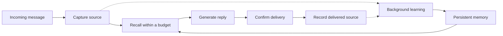

# Agent Memory

**A human-inspired memory engine for AI agents.**

English | [简体中文](README.zh-CN.md)

Help your agent carry useful memories across conversations—with layered recall, selective forgetting, and traceable sources.

Agent Memory runs as a local service. Connect your agent's conversation lifecycle once, and the runtime captures messages, prepares relevant memory before replies, and learns in the background. The agent keeps the same brain across process restarts and changes to its configured reply model.

[Quickstart](#quickstart) · [Python integration](#python-integration) · [How memory works](#how-memory-works) · [Status and verification](#status-and-verification) · [Full reference](docs/reference.md)

> **Pre-release.** The synchronous text runtime is implemented; long-term memory quality is still being validated. Desktop installation is verified on macOS. MCP currently provides memory tools only. See [supported scope and known limits](#status-and-verification).

<a id="desktop-setup"></a>

## Quickstart

Install [uv](https://docs.astral.sh/uv/) and start Docker Desktop. You will need a Chat Completions-compatible model endpoint, model name, and API key; memory learning also requires JSON mode.

```sh
uv tool install --python 3.12 'agent-memory-runtime @ https://github.com/chriswu727/agent-memory/archive/refs/heads/main.zip'
agent-memory desktop setup
agent-memory desktop configure-chat --use-cognition
agent-memory desktop chat
```

During `setup`, enter the provider details for memory learning. `configure-chat --use-cognition` explicitly reuses that configuration for replies. To use a different reply model, run `agent-memory desktop configure-chat` without the flag.

Setup creates a persistent brain and starts its database, API, and background worker. You do not need to clone the repository or start these services separately. If the installed command is missing from your shell, run `uv tool update-shell` and reopen the terminal.

**Storage is local; model processing follows your provider configuration.** Chat and semantic learning can incur API charges and send relevant content to that provider. Skipping cognition setup leaves storage and lexical recall available, but disables model-driven learning. Slow reasoning models may need the explicit [reasoning preset and provider controls](docs/reference.md#desktop-setup).

### Try continuity across conversations

Start with an ordinary task, such as:

> I'm drafting a short story. Half-hour writing sessions work best for me.

Continue the conversation, then enter `/quit`. Check background learning and open another conversation in the same installation:

```sh
agent-memory desktop learning-status
agent-memory desktop chat --conversation writing-followup
```

Ask for help planning the next writing session. This lets you explore whether earlier feedback helps with a new request, without manually calling a save or search tool. A new conversation reuses the same brain; it is not a separate user's privacy boundary. If learning is pending or blocked, inspect its status before interpreting the result.

This is a suggested hands-on exercise, not a prerecorded result or a guarantee of recall. A [bounded real-model diagnostic](evaluations/v1-2026-10-25-preference-use.md) records a related successful use of a half-hour preference alongside remaining answer-quality defects.

<a id="automatic-integration"></a>

## Python integration

After desktop setup and chat configuration, install the package in your application's Python 3.12+ environment too. Run this from a project with an active virtual environment or a `.venv` directory. The CLI's isolated environment does not make the SDK importable in your application.

```sh
uv pip install 'agent-memory-runtime @ https://github.com/chriswu727/agent-memory/archive/refs/heads/main.zip'
```

The following terminal example uses your saved model configuration and persistent brain:

```python
from agent_memory.agent_session import open_agent
from agent_memory.runtime import DeliveryReceipt


def deliver(request):
    print(request.text, flush=True)
    return DeliveryReceipt("delivered")


with open_agent(conversation_id="writing", deliver=deliver) as agent:
    agent.respond(
        "Help me plan my next writing session.",
        message_id="writing-request-001",
    )
```

Run this in a Python 3.12+ environment. In a real host, replace `deliver` with the actual sending operation and return success only when sending is confirmed. The example confirms a terminal write, not that a person read the answer. Give each new incoming message a stable unique ID and reuse that ID only when reconciling the same message. Replaying a completed message does not generate or deliver another response.

For your own model callback, delivery channel, recovery handling, or optional answer reviewer, see the [automatic integration reference](docs/reference.md#automatic-integration). HTTP and TypeScript clients expose the underlying operations; the ready-made automatic text runtime is currently Python.

<a id="mcp"></a>

## Connect through MCP

After setup, generate the configuration for a stdio MCP host:

```sh
agent-memory desktop mcp-config
```

Add the generated configuration to your host. The bridge starts or connects to the same local service and exposes memory tools.

**MCP is currently `tools_only`.** It does not intercept every conversation, confirm delivery, or take over compaction. Automatic capture and pre-answer recall require lifecycle integration through the Python runtime or a host adapter. Dedicated QQ/framework plugins and an OpenAI-compatible memory gateway have not been delivered. [MCP reference](docs/reference.md#mcp).

## How memory works

“Human-inspired” describes the design direction: different forms of memory, changing accessibility, cue-based recall, and learning from new evidence. Biological equivalence and human-level reliability have not been established.



| Mechanism | What the runtime does |
| --- | --- |
| Working and long-term memory | Combines bounded recent context with persistent episodic, semantic, and procedural representations. |
| Selective forgetting | Adjusts accessibility using age, representation, retention priority, and recorded use. Important memories can be protected. Lower accessibility is separate from deleting data. |
| Cue-based recall | Uses lexical retrieval, optional semantic embeddings, and bounded contextual links to find candidates. Relevant short replies can be reached through adjacent sources. |
| Revision and uncertainty | Keeps source versions, conditions, conflicts, and applicability labels so new information can qualify older memories. |
| Traceable learning | Retains supporting source references and checks proposed memories before publication. Model judgments remain fallible. |
| Persistent identity | Keeps the brain separate from the reply model and process, with explicit scope, restart, and recovery handling. |

The current context still has a limit. The runtime selects memory within that budget; long-term state is stored separately from the current model prompt. Detailed behavior is documented in the [architecture](architecture/architecture.html), [retrieval design](architecture/conversation-retrieval.md), and [runtime reference](docs/reference.md).

## Local operation

```sh
agent-memory desktop status
agent-memory desktop logs
agent-memory desktop learning-status
agent-memory desktop stop
agent-memory desktop start
```

Stopping the service retains committed memories. The next chat, MCP, or SDK connection can start it again. Configuration lives in the installation directory; memory content lives in its Docker database volume. Copying the configuration directory alone is not a database backup.

See [updating and configuration](docs/reference.md#local-status-and-configuration), [backup and recovery](architecture/desktop-recovery.md), and [troubleshooting](architecture/integration-troubleshooting.md). No management UI is required.

<a id="current-implementation-boundaries"></a>
<a id="verification"></a>

## Status and verification

The current release candidate supports **local synchronous text agents**, with a Python runtime, HTTP API, TypeScript client, MCP tools, and a direct terminal chat entry point. Core memory behavior is independent of chat frameworks. Desktop end-to-end verification currently covers **macOS with uv and Docker**.

The [memory-quality verification baseline](evaluations/v1-2026-10-25-memory-efficiency.md) records:

- **5,234 passed** in the full candidate source suite, with four Docker-gated skips exercised separately. Restoring the existing default verification format then passed 311 focused source checks.
- Installed-package checks cover memory processing, migration and desktop/chat flows. The report distinguishes the experimental candidate from the final default configuration; overlapping groups are not an aggregate count.
- Four paired DeepSeek verifier calls measured lower input use for experimental shared sources, but a citation-fidelity concern prevented default promotion. Earlier [bounded host observations](evaluations/v1-2026-10-25-preference-use.md) also retain whole-answer defects. Neither diagnostic passes longitudinal acceptance.

The [latest preparation follow-up](evaluations/v1-2026-10-25-learning-preparation.md) removes repeated working-state reads and comparison discovery while preserving model-facing plans. The configured model owns semantic memory decisions; the runtime retains evidence and lifecycle constraints.

Version 0.1.0 is now in [release closeout](docs/releasing.md): scope is frozen while longitudinal acceptance and final packaging are completed. The [changelog](CHANGELOG.md) remains an unreleased draft.

Known limits remain visible: a model can treat historical information as current fact, retrieval can include irrelevant material, and semantic verification can reject valid proposals. Full longitudinal acceptance and real elapsed-time aging remain incomplete. Streaming, tool loops, multimodal input, native one-click installation, and full integration into arbitrary AI clients are not currently delivered; Windows/Linux desktop acceptance has not been run on actual machines. Personality and emotion modeling are future research.

<a id="manual-deepseek-evaluation"></a>

Read the [acceptance criteria](architecture/v1-acceptance.md), [closed longitudinal failure](evaluations/v1-2026-10-25-longitudinal-v5-stopped.md), and [evaluation reference](docs/reference.md#manual-deepseek-evaluation) for reproducible methods, preserved failures, and evidence boundaries. All historical reports remain available.

## Documentation

| Start here | Contents |
| --- | --- |
| [Runtime and integration reference](docs/reference.md) | Detailed setup, model configuration, SDK/API/MCP, limits, monitoring, and evaluation commands. |
| [Architecture and acceptance specification](architecture/architecture.html) | Memory structures, system responsibilities, and the larger design. |
| [Automatic runtime contract](architecture/autonomous-runtime.contract.json) | Lifecycle responsibilities, integration requirements, and implementation boundaries. |
| [Cognitive budget controls](architecture/cognitive-budgets.md) | Explicit model-call allowances, accounting, and configuration. |
| [Memory quality and efficiency](architecture/memory-quality-and-efficiency.md) | Measured costs, algorithm choices, and boundaries for future personality and emotion research. |
| [Development setup](docs/reference.md#development-setup) | Clone-based setup, database migrations, and the worker. |
| [Local verification](docs/reference.md#verification) | Test commands and the scope of existing evidence. |

## Feedback and contributions

Building an agent with persistent memory? [Share your use case or an installation problem](https://github.com/chriswu727/agent-memory/issues). Reports with reproducible steps, redacted logs, and the integration you use are especially helpful. Repository documentation and developer-facing contributions use English; this overview is also maintained in [简体中文](README.zh-CN.md).

If the project is useful to you, **star the repository** and help us identify the next integration that matters. Local checks are preferred; GitHub Actions remains manual-only.

## License

Licensed under the [MIT License](LICENSE).
