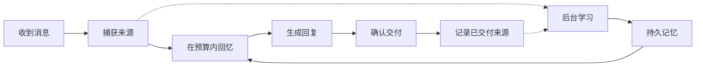

# memBrain

**受人类记忆机制启发的 AI Agent 记忆引擎。**

[English](README.md) | 简体中文

memBrain 原名 Agent Memory。已有的安装、数据目录和 `agent_memory` 导入均可继续使用。

通过分层回忆、选择性遗忘和可追溯来源，让 Agent 在不同对话之间保留并使用有用的记忆。

memBrain 以本地服务运行。将 Agent 的对话生命周期接入一次后，运行时会自动捕获消息，在回复前准备相关记忆，并在后台学习。进程重启或切换已配置的回复模型后，Agent 仍使用同一个大脑。

[Claude Code 插件](#claude-code-plugin) · [为什么选择 memBrain](#why-membrain) · [快速开始](#quickstart) · [Python 接入](#python-integration) · [记忆如何工作](#how-memory-works) · [状态与验证](#status-and-verification) · [完整参考](docs/reference.md)

> **预发布阶段。** 同步文本运行时已实现，长期记忆质量仍在验证中。Claude Code 插件和无需 Docker 的嵌入式数据库是新增功能，目前仅在 Linux x86_64 上验证。使用 Docker 的桌面安装已在 macOS 上验证。详见[支持范围与已知限制](#status-and-verification)。

<a id="claude-code-plugin"></a>

## 在 Claude Code 中使用

对你的 Agent 说：

> 安装 memBrain 插件：`claude plugin install membrain --marketplace chriswu727/membrain`

也可以在 Claude Code 会话中运行 `/plugin install membrain --marketplace chriswu727/membrain`。唯一的前置条件是 [uv](https://docs.astral.sh/uv/)。不需要 Docker、配置向导或额外的模型 API key。

从下一个会话开始，插件会：

- 在本地记录每条消息和 Claude 的最终回复；
- 让 Claude 为持久事实（健康限制、人物、日期、预算、偏好等）记下简短笔记，并在每个会话开始时注入这些笔记和用户最近的消息；
- 在每次回复前召回相关的早期消息：按关键词匹配，本地模型安装后还会跨语言按语义匹配；
- 为 Claude 提供记忆工具，用于主动检索、记录简短笔记以及按用户要求删除。

第一个会话会在后台安装运行时和嵌入式 PostgreSQL 数据库；就绪之前发送的消息会先排队，就绪后再存入。自动召回按关键词匹配当前消息；本地多语言模型（约 135 MB，无需 API key）在后台下载完成后，还会按语义跨语言匹配。当问题涉及个人背景时，Claude 也会被引导主动检索记忆。可通过设置 `HF_ENDPOINT` 从 Hugging Face 镜像下载该模型。运行 `membrain plugin ui` 可打开本地记忆页面，查看、更正和删除已记住的内容，暂停记录，或导出全部数据。除非你配置了模型服务，否则不会启用由模型驱动的后台学习。记忆保存在你的用户数据目录（例如 Linux 上的 `~/.local/share/membrain`），由你的各个会话共享。设计、验证和限制详见[插件模式](architecture/plugin-mode.md)。

其他 MCP 宿主可以添加一个 stdio 服务器，运行 `uvx --python 3.12 --from "membrain-ai[embedded,semantic] @ git+https://github.com/chriswu727/membrain" membrain plugin mcp`。这样可以使用记忆工具，但不会自动记录。

**Codex。** 同一个插件也可以在 OpenAI Codex 中使用：

```sh
codex plugin marketplace add chriswu727/memBrain
codex plugin add membrain@membrain
```

下次启动时 Codex 会请你审核插件的 hooks；请选择信任（也可以之后用 `/hooks` 信任），因为 Codex 不会运行未受信任的 hooks。之后 Codex 获得与 Claude Code 相同的笔记、历史、召回、记录和记忆工具，同一台电脑上两者共享同一份记忆。已在 Linux 上用 Codex CLI 0.165 验证：在一个会话中告诉它的事实出现在了下一个会话的上下文里。

**QQ、微信、Telegram 等平台上的聊天机器人。** [AstrBot 插件](integrations/astrbot/README.zh-CN.md)为每一个和 AstrBot 机器人聊天的人提供独立的长期记忆，适用于 AstrBot 支持的所有平台和模型服务（包括 DeepSeek）。一个人说过的话永远不会出现在给另一个人的回复里，群聊默认也与私聊分开保存。该插件已在 Windows 11 上的 AstrBot 4.29.3 中配合 DeepSeek、通过 AstrBot 自带的 WebChat 实际运行（两个用户互相隔离、跨对话召回、笔记与检索）；尚未通过 NapCat 接入 QQ 测试。

**任何可设置 `base_url` 的机器人（抖音和 B 站直播、NoneBot、Koishi、SillyTavern 等）。** [`membrain proxy`](integrations/openai-proxy/README.zh-CN.md) 是一个 OpenAI 兼容代理：把机器人的 `base_url` 从 DeepSeek 等模型服务改为指向它，每个人（通过请求的 `user` 字段或请求头区分）就有了自己的记忆。已在 Windows 11 上接入真实的 DeepSeek API 运行，流式和非流式回复都已验证；尚未配合具体的机器人项目运行。

**WorkBuddy 和 CodeBuddy。** 同一个插件也可以安装到腾讯的 WorkBuddy 和 CodeBuddy。在 WorkBuddy 中打开 **插件 → +**，添加插件市场 `https://raw.githubusercontent.com/chriswu727/memBrain/main/.codebuddy-plugin/marketplace.json`，然后安装 **membrain**；在 CodeBuddy Code 中运行 `codebuddy plugin marketplace add chriswu727/memBrain` 和 `codebuddy plugin install membrain@membrain`。由于这些宿主不会把最终回复传给 Stop hook，memBrain 会从会话记录中读取回复。该 hook 流程已在 Linux 上用模拟的 WorkBuddy hook 输入验证，并在 Windows 11 上通过 WorkBuddy 5.8.3 自带、也用来运行 hook 的 Git Bash 验证；尚未在 WorkBuddy 或 CodeBuddy 应用内实际运行。

**OpenClaw。** [OpenClaw 插件](integrations/openclaw/README.zh-CN.md)为 OpenClaw 助手在每个渠道上加入同一份记忆，与 OpenClaw 自带的记忆并行工作。Windows 11 上真实的 OpenClaw 2026.10.8 Gateway 已加载该插件，并在关闭 OpenClaw 自带记忆的情况下，配合 DeepSeek 在新会话中召回了之前的事实。

**Hermes Agent。** memBrain 也可以作为 Hermes Agent 的记忆后端。把它安装到 Hermes 的 Python 环境并选用：

```sh
uv pip install --python ~/.hermes/hermes-agent/.venv/bin/python 'membrain-ai[embedded,semantic] @ git+https://github.com/chriswu727/membrain'
hermes config set memory.provider membrain   # 或：hermes memory setup
```

之后 Hermes 会在每个会话开始时注入你的笔记和最近消息，在每次回复前加入相关的早期消息，记录每一轮对话，并获得 `membrain_note`、`membrain_search`、`membrain_pause` 和 `membrain_resume` 工具。写入 Hermes 内置 `MEMORY.md`／`USER.md` 的内容会同步为笔记。默认 Hermes 配置档与同一台电脑上的 Claude Code 共享记忆；其他配置档各自独立。该适配器已按 Hermes 的接口和真实 memBrain 服务测试，但尚未在真实的 Hermes 安装中运行过。

<a id="why-membrain"></a>

## 为什么选择 memBrain

- **可追溯，不改写。** 每条记忆都保留是谁说的、什么时候说的。召回的内容会标明是历史数据，模型能区分“你说过的话”和“它曾经的建议”。
- **本地、私有。** 一条命令即可在本机安装嵌入式数据库；无需 Docker、云账号或额外的模型 key，由你正在使用的宿主模型负责理解。
- **不打扰宿主。** 钩子出错时直接放行：记忆不可用时，Agent 照常回复，记录会先排队，恢复后再写入。
- **可审计的遗忘。** 删除会被登记，从旧备份恢复后也不会“复活”。
- **公开评测。** 评测结果（包括失败的）连同方法和成本一并公开。人格与情绪建模属于规划中的研究，目前尚未实现。

<a id="desktop-setup"></a>
<a id="quickstart"></a>

## 快速开始

安装 [uv](https://docs.astral.sh/uv/)。准备好兼容 Chat Completions 的模型服务地址、模型名称和 API key；记忆学习还要求模型支持 JSON 模式。

```sh
uv tool install --python 3.12 'membrain-ai[embedded,semantic] @ https://github.com/chriswu727/membrain/archive/refs/heads/main.zip'
membrain desktop setup
membrain desktop configure-chat --use-cognition
membrain desktop chat
```

在 `setup` 中填写用于记忆学习的模型配置。`configure-chat --use-cognition` 明确选择复用这份配置来生成回复。如需使用不同的回复模型，请运行不带该参数的 `membrain desktop configure-chat`。

设置会创建一个持久大脑，并启动数据库、API 和后台任务处理器。在 macOS、Windows 或 Linux x86_64 上使用 Python 3.12 并安装 `embedded` 附加组件时，数据库以嵌入式 PostgreSQL 运行，无需 Docker；其他环境下设置会使用 Docker Desktop（可用 `--database docker|embedded` 指定）。无需克隆仓库，也无需分别启动这些服务。如果终端找不到安装后的命令，请运行 `uv tool update-shell`，然后重新打开终端。

**数据存储在本地；模型处理取决于你配置的提供方。** 聊天和语义学习可能产生 API 费用，并将相关内容发送给该提供方。跳过认知模型配置后，仍可使用存储和词面回忆，但模型驱动的学习会被禁用。较慢的推理模型可能需要显式启用[推理预设并调整提供方配置](docs/reference.md#desktop-setup)。

### 体验跨会话的连续性

先聊一个普通任务，例如：

> 我正在写一篇短篇小说。每次写半小时最适合我。

继续交流，然后输入 `/quit`。查看后台学习状态，再在同一安装中打开另一段对话：

```sh
membrain desktop learning-status
membrain desktop chat --conversation writing-followup
```

请 Agent 帮你安排下一次写作。这个练习可以让你观察早先的反馈是否帮助了新的请求，无需手动调用保存或搜索工具。新会话沿用同一个大脑，不是不同用户之间的隐私边界。如果学习仍在等待或已被阻塞，请先检查状态，再解读结果。

这是一个建议亲自尝试的练习，不是预先录制的结果，也不保证一定能回忆成功。[有界真实模型诊断](evaluations/v1-2026-10-25-preference-use.md)记录了一个相关案例：模型成功使用了半小时偏好，但整段回答仍存在质量问题。

<a id="automatic-integration"></a>
<a id="python-integration"></a>

## Python 接入

完成桌面设置和聊天配置后，还需在应用自己的 Python 3.12+ 环境中安装此包。请在已激活虚拟环境或包含 `.venv` 目录的项目中运行以下命令。CLI 使用的隔离环境不会让应用自动获得可导入的 SDK。

```sh
uv pip install 'membrain @ https://github.com/chriswu727/membrain/archive/refs/heads/main.zip'
```

下面的终端示例会使用已保存的模型配置和持久大脑：

```python
from membrain.agent_session import open_agent
from membrain.runtime import DeliveryReceipt


def deliver(request):
    print(request.text, flush=True)
    return DeliveryReceipt("delivered")


with open_agent(conversation_id="writing", deliver=deliver) as agent:
    agent.respond(
        "Help me plan my next writing session.",
        message_id="writing-request-001",
    )
```

请在 Python 3.12+ 环境中运行。在实际宿主中，将 `deliver` 替换为真实的发送操作，并只在确认发送成功后返回成功回执。此示例确认的是终端写入，不代表有人已经阅读回答。每条新输入都需要一个稳定且唯一的消息 ID；只有在处理同一条消息的恢复或核对时，才复用该 ID。重放已完成的消息不会再次生成或交付回复。

如需自己的模型回调、交付渠道、恢复处理或可选的回答核验器，请参阅[自动接入参考](docs/reference.md#automatic-integration)。HTTP 和 TypeScript 客户端提供底层操作；目前开箱即用的自动文本运行时是 Python 版本。

<a id="mcp"></a>

## 通过 MCP 连接

完成设置后，为 stdio MCP 宿主生成配置：

```sh
membrain desktop mcp-config
```

将生成的配置添加到宿主。桥接进程会启动或连接同一个本地服务，并提供记忆工具。

**MCP 当前为 `tools_only`。** 它不会捕获每一段对话、确认消息交付或接管上下文压缩。自动捕获和回复前回忆需要通过 Python 运行时或宿主适配器接入对话生命周期。QQ／聊天框架专用插件和兼容 OpenAI 的记忆网关尚未交付。详见 [MCP 参考](docs/reference.md#mcp)。

<a id="how-memory-works"></a>

## 记忆如何工作

“受人类记忆机制启发”描述的是设计方向：不同形式的记忆、随时间和使用而变化的可访问性、线索引导的回忆，以及根据新证据进行学习。目前尚未证明其与生物记忆等价，也未达到经过验证的人类级可靠性。



| 机制 | 运行时的行为 |
| --- | --- |
| 工作记忆与长期记忆 | 将有界的近期上下文与持久保存的情节、语义和程序性记忆表示结合。 |
| 选择性遗忘 | 根据记忆年龄、表示形式、保留优先级和已记录的使用情况调整可访问性。重要记忆可以受到保护。降低可访问性与删除数据是不同操作。 |
| 按需展开细节 | 可以先呈现旧记忆经过核验的简短表达，在出现具体线索或明确检查来源时展开完整细节。原始记录仍然保存；是否生成简短表达由配置的模型选择。 |
| 线索引导的回忆 | 通过词面检索、可选的语义嵌入和有边界的上下文关联查找候选记忆。相关的简短回复也可通过相邻来源被找到。 |
| 修订与不确定性 | 保留来源版本、条件、冲突和适用性标记，使新信息能够限定旧记忆的含义与适用范围。 |
| 可追溯的学习 | 保留支持记忆的来源引用，并在发布前检查记忆提议。模型判断仍可能出错。 |
| 持久身份 | 将大脑与回复模型、进程分离，并显式处理作用范围、重启和恢复。 |

当前上下文仍有容量上限。运行时会在预算内选择记忆；长期状态独立于当前模型提示保存。详细行为见[架构](architecture/architecture.html)、[检索设计](architecture/conversation-retrieval.md)和[运行时参考](docs/reference.md)。

[保留来源的分层回忆设计](architecture/recall-resolution.md)说明了编码、线索展开和升级兼容性。没有经过核验的简短表达时，旧记忆仍使用完整视图；升级不会自动付费重写整个记忆库。

[忠于来源的表达机制](architecture/source-composition.md)区分事实细节与写作风格，并要求新版普通记忆、简短表达和事件分组通过人物动作检查。新的 AI 发言记忆保留来源引用，引用内部的叙述者不被擅自确定；写入前会重新按来源构造视图，而非信任改写文本。用户报告的事实仍支持语义提炼和经过核验的简短表达。有大小上限的完整原文上下文可以一起保留画面和原文表达的意义。宿主指令和模型判断仍可能出错；只安装记忆工具，无法强制任意 Agent 遵守写作约束。

## 本地运行

```sh
membrain desktop status
membrain desktop logs
membrain desktop learning-status
membrain desktop stop
membrain desktop start
```

停止服务会保留已提交的记忆。下一次聊天、MCP 或 SDK 连接可以重新启动服务。配置位于安装目录，记忆内容位于该安装的 Docker 数据库卷。仅复制配置目录不等于备份数据库。

参阅[更新与配置](docs/reference.md#local-status-and-configuration)、[备份与恢复](architecture/desktop-recovery.md)和[故障排查](architecture/integration-troubleshooting.md)。无需管理界面。

<a id="current-implementation-boundaries"></a>
<a id="verification"></a>
<a id="status-and-verification"></a>

## 状态与验证

当前候选版本支持**本地同步文本 Agent**，提供 Python 运行时、HTTP API、TypeScript 客户端、MCP 工具和直接终端聊天入口。核心记忆行为独立于聊天框架。桌面端到端验证目前覆盖 **macOS、uv 和 Docker** 的组合。

[插件模式](architecture/plugin-mode.md)已在 **Linux x86_64** 上完成端到端验证。嵌入式数据库分别以 root 和普通用户身份，通过了真实的启动、重启、备份、恢复和激活检查。在隔离配置的 Claude Code 2.1.311 中，插件从本地插件市场安装成功；使用模拟模型 API 时，插件记录了消息和回复，新会话发给模型的请求中包含上一个会话的记录。这项检查覆盖的是集成流程，不是回答质量。自动召回基于词语匹配。在一台 Windows 11 机器上，嵌入式数据库、本地服务、hook 启动脚本（Git Bash 与 `cmd.exe`）、代理以及 AstrBot 和 OpenClaw 插件都已实际运行；这次运行发现并修复了两个安装问题，它们会让所有新的 Windows 安装以及 AstrBot 首次启动失败。Claude Code 和 Codex 尚未在 Windows 上运行，macOS 尚未在真实设备上运行。

在一个全新的十会话场景上进行的[盲评 A/B 诊断](evaluations/v1-2026-10-27-ab-baselines.md)中，默认记忆运行时得 4.5 分（满分 12），无记忆基线得 2 分，直接放入完整历史的朴素做法得 11.5 分。记忆组消耗的 token 约为完整历史组的三十倍，并需要 58 次人工干预。它失分的主要原因是召回没有取回相关事实。在这样的小规模下，完整历史是更强的基线；更长的历史尚未测试。使用相同模型和用例对插件路径进行的[第二次盲评](evaluations/v1-2026-10-27-plugin-path-ab.md)中，插件在该场景得 10.5 分，完整历史得 11 分。在一个包含粘贴代码和日志的 34 会话长版本上，插件先得 7.5 分，针对问题改进历史注入和召回后得 12 分，完整历史得 11.5 分，插件消耗的 token 约为完整历史的四分之一。这些都是单次运行，且改进是在同一场景上设计的。由另一个智能体编写的[两个全新场景](evaluations/v1-2026-10-27-fresh-scenarios.md)对此做了检验：在第一个场景的长版本上，当时已合并的插件（含本地语义召回）只得 6 分，完整历史得 11 分。随后的重新设计（由宿主模型维护笔记、按整条消息召回）在预留的第二个场景长版本上得 11.5 分，与完整历史相同，而之前的插件只得 5.5 分，token 消耗约为完整历史的三分之一。这只是使用一个宿主模型（DeepSeek V4 Pro）的单次运行。

[记忆质量验证基线](evaluations/v1-2026-10-25-memory-efficiency.md)记录了：

- 完整候选源码测试中 **5,234 项通过**，四项受 Docker 条件限制而跳过的测试已另行执行。随后恢复原有默认核验格式，又通过了 311 项重点源码检查。
- 安装包检查覆盖记忆处理、迁移和桌面／聊天流程。报告区分了实验候选版本与最终默认配置；有重叠的测试组不能相加作为独立总数。
- 四次配对 DeepSeek 核验调用测得实验性共享来源格式的输入消耗更低，但引用准确性问题阻止了它成为默认格式。此前的[有界宿主观察](evaluations/v1-2026-10-25-preference-use.md)也仍有整段回答缺陷。这些诊断均不代表通过长线验收。

[最新准备流程改进](evaluations/v1-2026-10-25-learning-preparation.md)减少了重复读取工作记忆和重复发现比较候选的开销，保持模型收到的计划不变。语义层面的记忆决策由接入模型负责，运行时保留证据与生命周期约束。

[多场景长线诊断](evaluations/v1-2026-10-26-longitudinal-round.md)在同一个持久化大脑上走过了十六次会话的全部 33 条输入，完成 32 条回复，并保留一次超时失败。场景跨越 56 个虚构日，并非实际运行了 56 天。它暴露了重要记忆未被召回、回忆出现无依据细节、回复语言偏移和认知处理成本较高的问题。独立提示回忆与访问年龄诊断及原始证据均已记录；**行为验收没有通过**。

[修复后续报告](evaluations/v1-2026-10-26-longitudinal-repairs.md)记录了有效陈述误判、区分性线索排序、相邻原文意义取回、助手发言归属、索引与近期记忆分数校准，以及事件关联慢查询的修复。[架构说明](architecture/longitudinal-repairs.md)解释了兼容方式和剩余限制。原长线失败结果继续保留；这些修复不代表重新通过了完整验收。

[保留来源的分层回忆后续报告](evaluations/v1-2026-10-26-recall-resolution.md)记录了可选且经过核验的简短表达、线索展开和更小的本地编码输入，原始记录仍然保存。专项检查覆盖展开、持久化和明确删除；真实模型诊断仍有卡片补写细节、事件分组措辞含糊，以及小型编码案例尚未展示自动形成简短表达的问题。这些结果不代表通过长线验收。

[后续发布场景验收](evaluations/v1-2026-10-26-release-longitudinal.md)在交付十一条回复后停止：两条配文遗漏了已保存的个人意义，一条普通助手发言摘要混淆了人物动作，另有引用格式错误中止了学习。原始证据与用量继续保留。后续修复把核验扩展到普通记忆，并提供有大小上限的完整来源消息；本地检查本身不代表重新通过行为验收。

[下一轮来源连贯性测试](evaluations/v1-2026-10-26-coherent-recall.md)遇到了宿主推理输出上限，后续诊断又发现固定日程未被取回。[来源单元修复](evaluations/v1-2026-10-26-source-capsules.md)同时处理候选名额和上下文中的重复拥挤，已通过 5,591 项源码检查、430 项安装包检查和四条桌面流程。配对 SQL 回放能在原预算内保留固定安排。之后在同一记忆库上的诊断有三次回复正确，但后台从第一人称代写文本中写入了错误的人物归属，已在复核时结束。行为验收仍未通过；失败与未执行案例继续保留。

0.1.0 版本仍处于[发布收尾阶段](docs/releasing.md)：功能范围冻结，接下来修复已观察到的缺陷并完成验收。[更新日志](CHANGELOG.md)仍是未发布草稿。

[按来源构造发言记忆的候选版本](evaluations/v1-2026-10-26-communication-views.json)修复代写口吻被错误归为 AI 经历的写入路径，没有新增模型调用。最终本地检查通过了 5,660 项源码测试、497 项安装包检查、四条桌面流程、40 项 TypeScript 测试及严格类型检查；122 个运行时文件一致。随后新的真实模型测试在首次编码时因重复来源撑大核验输入而停止：两次调用、24,088 个已知 token、一条回复，尚无完整学习轮次。[来源共享修复](evaluations/v1-2026-10-26-shared-communication.json)保留这次失败，并已在原预算内缩小同一个真实失败请求。行为验收仍未通过。

来源共享版本已通过 5,717 项源码测试、524 项安装包检查和全部四条独立安装后的桌面流程。随后[固定方案的多场景测试](evaluations/v1-2026-10-26-shared-communication-longitudinal.json)交付了全部 26 条输入：18 项整段回答案例中 17 项通过，最后的地图标签因无关的修架子计划挤掉原始场景细节而失败。测试已停止，116 次调用的用量全部明确，没有重试。[关系邻域排序修复](evaluations/v1-2026-10-26-belief-inheritance.md)让补入的关联记忆继承查询相关性，零模型 SQL 回放能在原上下文预算内恢复完整场景。原回答仍记为失败；修复后的真实模型回答，以及有用的随年龄变化的摘要回忆，仍未验证。行为验收尚未通过。

已知限制仍然存在：模型可能把历史信息当作当前事实，检索可能包含无关内容，语义核验也可能拒绝有效提议。完整长线验收和真实时间流逝下的老化验证尚未完成。目前尚未交付流式输出、工具循环、多模态输入、原生一键安装，以及对任意 AI 客户端的完整接入；Windows／Linux 桌面端尚未进行实机验收。性格与情绪建模属于后续研究方向。

<a id="manual-deepseek-evaluation"></a>

[验收标准](architecture/v1-acceptance.md)、[已关闭的长线失败记录](evaluations/v1-2026-10-25-longitudinal-v5-stopped.md)和[评估参考](docs/reference.md#manual-deepseek-evaluation)提供可复现的方法、保留的失败结果与证据边界。所有历史报告继续保留。

## 文档

| 入口 | 内容 |
| --- | --- |
| [运行时与接入参考](docs/reference.md) | 详细设置、模型配置、SDK／API／MCP、限制、监控和评估命令。 |
| [架构与验收规范](architecture/architecture.html) | 记忆结构、系统职责和完整设计。 |
| [自动运行时契约](architecture/autonomous-runtime.contract.json) | 生命周期职责、接入要求和实现边界。 |
| [认知预算控制](architecture/cognitive-budgets.md) | 明确的模型调用额度、用量记录和配置。 |
| [记忆质量与效率](architecture/memory-quality-and-efficiency.md) | 实测开销、算法选择，以及未来人格与情绪研究的架构边界。 |
| [路线图：面向聊天与生活类 Agent 的记忆](architecture/companion-roadmap.md) | 规划中的工作：与其他记忆工具功能对齐，记住人物、计划与关系，然后是人格与情绪。尚未实现。 |
| [开发设置](docs/reference.md#development-setup) | 克隆仓库后的设置、数据库迁移和后台任务处理器。 |
| [本地验证](docs/reference.md#verification) | 测试命令和现有证据的覆盖范围。 |

## 反馈与贡献

正在为 Agent 加入持久记忆？欢迎[分享使用场景或安装问题](https://github.com/chriswu727/membrain/issues)。可复现步骤、已脱敏的日志和你使用的接入方式尤其有帮助。仓库文档及面向开发者的贡献使用英文。本页是中文概览；[英文首页](README.md)为默认入口。

如果项目对你有帮助，欢迎 **Star 仓库**，并帮助我们确定下一项值得支持的接入方式。优先使用本地检查；GitHub Actions 保持仅手动运行。

## 许可证

本项目采用 [MIT 许可证](LICENSE)。
