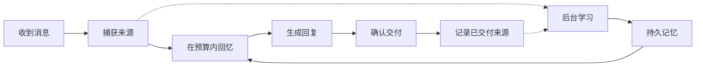

# Agent Memory

**受人类记忆机制启发的 AI Agent 记忆引擎。**

[English](README.md) | 简体中文

通过分层回忆、选择性遗忘和可追溯来源，让 Agent 在不同对话之间保留并使用有用的记忆。

Agent Memory 以本地服务运行。将 Agent 的对话生命周期接入一次后，运行时会自动捕获消息，在回复前准备相关记忆，并在后台学习。进程重启或切换已配置的回复模型后，Agent 仍使用同一个大脑。

[快速开始](#quickstart) · [Python 接入](#python-integration) · [记忆如何工作](#how-memory-works) · [状态与验证](#status-and-verification) · [完整参考](docs/reference.md)

> **预发布阶段。** 同步文本运行时已实现，长期记忆质量仍在验证中。桌面安装已在 macOS 上验证。MCP 目前仅提供记忆工具。详见[支持范围与已知限制](#status-and-verification)。

<a id="desktop-setup"></a>
<a id="quickstart"></a>

## 快速开始

安装 [uv](https://docs.astral.sh/uv/)，并启动 Docker Desktop。准备好兼容 Chat Completions 的模型服务地址、模型名称和 API key；记忆学习还要求模型支持 JSON 模式。

```sh
uv tool install --python 3.12 'agent-memory-runtime @ https://github.com/chriswu727/agent-memory/archive/refs/heads/main.zip'
agent-memory desktop setup
agent-memory desktop configure-chat --use-cognition
agent-memory desktop chat
```

在 `setup` 中填写用于记忆学习的模型配置。`configure-chat --use-cognition` 明确选择复用这份配置来生成回复。如需使用不同的回复模型，请运行不带该参数的 `agent-memory desktop configure-chat`。

设置会创建一个持久大脑，并启动数据库、API 和后台任务处理器。无需克隆仓库，也无需分别启动这些服务。如果终端找不到安装后的命令，请运行 `uv tool update-shell`，然后重新打开终端。

**数据存储在本地；模型处理取决于你配置的提供方。** 聊天和语义学习可能产生 API 费用，并将相关内容发送给该提供方。跳过认知模型配置后，仍可使用存储和词面回忆，但模型驱动的学习会被禁用。较慢的推理模型可能需要显式启用[推理预设并调整提供方配置](docs/reference.md#desktop-setup)。

### 体验跨会话的连续性

先聊一个普通任务，例如：

> 我正在写一篇短篇小说。每次写半小时最适合我。

继续交流，然后输入 `/quit`。查看后台学习状态，再在同一安装中打开另一段对话：

```sh
agent-memory desktop learning-status
agent-memory desktop chat --conversation writing-followup
```

请 Agent 帮你安排下一次写作。这个练习可以让你观察早先的反馈是否帮助了新的请求，无需手动调用保存或搜索工具。新会话沿用同一个大脑，不是不同用户之间的隐私边界。如果学习仍在等待或已被阻塞，请先检查状态，再解读结果。

这是一个建议亲自尝试的练习，不是预先录制的结果，也不保证一定能回忆成功。[有界真实模型诊断](evaluations/v1-2026-10-25-preference-use.md)记录了一个相关案例：模型成功使用了半小时偏好，但整段回答仍存在质量问题。

<a id="automatic-integration"></a>
<a id="python-integration"></a>

## Python 接入

完成桌面设置和聊天配置后，还需在应用自己的 Python 3.12+ 环境中安装此包。请在已激活虚拟环境或包含 `.venv` 目录的项目中运行以下命令。CLI 使用的隔离环境不会让应用自动获得可导入的 SDK。

```sh
uv pip install 'agent-memory-runtime @ https://github.com/chriswu727/agent-memory/archive/refs/heads/main.zip'
```

下面的终端示例会使用已保存的模型配置和持久大脑：

```python
from agent_memory.agent_session import open_agent
from agent_memory.runtime import DeliveryReceipt


def deliver(request):
    print(request.text, flush=True)
    return DeliveryReceipt("delivered")


with open_agent(conversation_id="writing", deliver=deliver) as agent:
    agent.respond(
        "Help me plan my next writing session.",
        message_id="writing-request-001",
    )
```

请在 Python 3.12+ 环境中运行。在实际宿主中，将 `deliver` 替换为真实的发送操作，并只在确认发送成功后返回成功回执。此示例确认的是终端写入，不代表有人已经阅读回答。每条新输入都需要一个稳定且唯一的消息 ID；只有在处理同一条消息的恢复或核对时，才复用该 ID。重放已完成的消息不会再次生成或交付回复。

如需自己的模型回调、交付渠道、恢复处理或可选的回答核验器，请参阅[自动接入参考](docs/reference.md#automatic-integration)。HTTP 和 TypeScript 客户端提供底层操作；目前开箱即用的自动文本运行时是 Python 版本。

<a id="mcp"></a>

## 通过 MCP 连接

完成设置后，为 stdio MCP 宿主生成配置：

```sh
agent-memory desktop mcp-config
```

将生成的配置添加到宿主。桥接进程会启动或连接同一个本地服务，并提供记忆工具。

**MCP 当前为 `tools_only`。** 它不会捕获每一段对话、确认消息交付或接管上下文压缩。自动捕获和回复前回忆需要通过 Python 运行时或宿主适配器接入对话生命周期。QQ／聊天框架专用插件和兼容 OpenAI 的记忆网关尚未交付。详见 [MCP 参考](docs/reference.md#mcp)。

<a id="how-memory-works"></a>

## 记忆如何工作

“受人类记忆机制启发”描述的是设计方向：不同形式的记忆、随时间和使用而变化的可访问性、线索引导的回忆，以及根据新证据进行学习。目前尚未证明其与生物记忆等价，也未达到经过验证的人类级可靠性。



| 机制 | 运行时的行为 |
| --- | --- |
| 工作记忆与长期记忆 | 将有界的近期上下文与持久保存的情节、语义和程序性记忆表示结合。 |
| 选择性遗忘 | 根据记忆年龄、表示形式、保留优先级和已记录的使用情况调整可访问性。重要记忆可以受到保护。降低可访问性与删除数据是不同操作。 |
| 按需展开细节 | 可以先呈现旧记忆经过核验的简短表达，在出现具体线索或明确检查来源时展开完整细节。原始记录仍然保存；是否生成简短表达由配置的模型选择。 |
| 线索引导的回忆 | 通过词面检索、可选的语义嵌入和有边界的上下文关联查找候选记忆。相关的简短回复也可通过相邻来源被找到。 |
| 修订与不确定性 | 保留来源版本、条件、冲突和适用性标记，使新信息能够限定旧记忆的含义与适用范围。 |
| 可追溯的学习 | 保留支持记忆的来源引用，并在发布前检查记忆提议。模型判断仍可能出错。 |
| 持久身份 | 将大脑与回复模型、进程分离，并显式处理作用范围、重启和恢复。 |

当前上下文仍有容量上限。运行时会在预算内选择记忆；长期状态独立于当前模型提示保存。详细行为见[架构](architecture/architecture.html)、[检索设计](architecture/conversation-retrieval.md)和[运行时参考](docs/reference.md)。

[保留来源的分层回忆设计](architecture/recall-resolution.md)说明了编码、线索展开和升级兼容性。没有经过核验的简短表达时，旧记忆仍使用完整视图；升级不会自动付费重写整个记忆库。

[忠于来源的表达机制](architecture/source-composition.md)区分事实细节与写作风格，并要求新版普通记忆、简短表达和事件分组通过人物动作检查。新的 AI 发言记忆保留来源引用，引用内部的叙述者不被擅自确定；写入前会重新按来源构造视图，而非信任改写文本。用户报告的事实仍支持语义提炼和经过核验的简短表达。有大小上限的完整原文上下文可以一起保留画面和原文表达的意义。宿主指令和模型判断仍可能出错；只安装记忆工具，无法强制任意 Agent 遵守写作约束。

## 本地运行

```sh
agent-memory desktop status
agent-memory desktop logs
agent-memory desktop learning-status
agent-memory desktop stop
agent-memory desktop start
```

停止服务会保留已提交的记忆。下一次聊天、MCP 或 SDK 连接可以重新启动服务。配置位于安装目录，记忆内容位于该安装的 Docker 数据库卷。仅复制配置目录不等于备份数据库。

参阅[更新与配置](docs/reference.md#local-status-and-configuration)、[备份与恢复](architecture/desktop-recovery.md)和[故障排查](architecture/integration-troubleshooting.md)。无需管理界面。

<a id="current-implementation-boundaries"></a>
<a id="verification"></a>
<a id="status-and-verification"></a>

## 状态与验证

当前候选版本支持**本地同步文本 Agent**，提供 Python 运行时、HTTP API、TypeScript 客户端、MCP 工具和直接终端聊天入口。核心记忆行为独立于聊天框架。桌面端到端验证目前覆盖 **macOS、uv 和 Docker** 的组合。

[记忆质量验证基线](evaluations/v1-2026-10-25-memory-efficiency.md)记录了：

- 完整候选源码测试中 **5,234 项通过**，四项受 Docker 条件限制而跳过的测试已另行执行。随后恢复原有默认核验格式，又通过了 311 项重点源码检查。
- 安装包检查覆盖记忆处理、迁移和桌面／聊天流程。报告区分了实验候选版本与最终默认配置；有重叠的测试组不能相加作为独立总数。
- 四次配对 DeepSeek 核验调用测得实验性共享来源格式的输入消耗更低，但引用准确性问题阻止了它成为默认格式。此前的[有界宿主观察](evaluations/v1-2026-10-25-preference-use.md)也仍有整段回答缺陷。这些诊断均不代表通过长线验收。

[最新准备流程改进](evaluations/v1-2026-10-25-learning-preparation.md)减少了重复读取工作记忆和重复发现比较候选的开销，保持模型收到的计划不变。语义层面的记忆决策由接入模型负责，运行时保留证据与生命周期约束。

[多场景长线诊断](evaluations/v1-2026-10-26-longitudinal-round.md)在同一个持久化大脑上走过了十六次会话的全部 33 条输入，完成 32 条回复，并保留一次超时失败。场景跨越 56 个虚构日，并非实际运行了 56 天。它暴露了重要记忆未被召回、回忆出现无依据细节、回复语言偏移和认知处理成本较高的问题。独立提示回忆与访问年龄诊断及原始证据均已记录；**行为验收没有通过**。

[修复后续报告](evaluations/v1-2026-10-26-longitudinal-repairs.md)记录了有效陈述误判、区分性线索排序、相邻原文意义取回、助手发言归属、索引与近期记忆分数校准，以及事件关联慢查询的修复。[架构说明](architecture/longitudinal-repairs.md)解释了兼容方式和剩余限制。原长线失败结果继续保留；这些修复不代表重新通过了完整验收。

[保留来源的分层回忆后续报告](evaluations/v1-2026-10-26-recall-resolution.md)记录了可选且经过核验的简短表达、线索展开和更小的本地编码输入，原始记录仍然保存。专项检查覆盖展开、持久化和明确删除；真实模型诊断仍有卡片补写细节、事件分组措辞含糊，以及小型编码案例尚未展示自动形成简短表达的问题。这些结果不代表通过长线验收。

[后续发布场景验收](evaluations/v1-2026-10-26-release-longitudinal.md)在交付十一条回复后停止：两条配文遗漏了已保存的个人意义，一条普通助手发言摘要混淆了人物动作，另有引用格式错误中止了学习。原始证据与用量继续保留。后续修复把核验扩展到普通记忆，并提供有大小上限的完整来源消息；本地检查本身不代表重新通过行为验收。

[下一轮来源连贯性测试](evaluations/v1-2026-10-26-coherent-recall.md)遇到了宿主推理输出上限，后续诊断又发现固定日程未被取回。[来源单元修复](evaluations/v1-2026-10-26-source-capsules.md)同时处理候选名额和上下文中的重复拥挤，已通过 5,591 项源码检查、430 项安装包检查和四条桌面流程。配对 SQL 回放能在原预算内保留固定安排。之后在同一记忆库上的诊断有三次回复正确，但后台从第一人称代写文本中写入了错误的人物归属，已在复核时结束。行为验收仍未通过；失败与未执行案例继续保留。

0.1.0 版本仍处于[发布收尾阶段](docs/releasing.md)：功能范围冻结，接下来修复已观察到的缺陷并完成验收。[更新日志](CHANGELOG.md)仍是未发布草稿。

[按来源构造发言记忆的候选版本](evaluations/v1-2026-10-26-communication-views.json)修复代写口吻被错误归为 AI 经历的写入路径，没有新增模型调用。最终本地检查通过了 5,660 项源码测试、497 项安装包检查、四条桌面流程、40 项 TypeScript 测试及严格类型检查；源码包、安装包和独立安装中的 122 个运行时文件一致。先前增加输入开销的回归及其修复记录均被保留。新的真实模型行为验收仍待完成。

已知限制仍然存在：模型可能把历史信息当作当前事实，检索可能包含无关内容，语义核验也可能拒绝有效提议。完整长线验收和真实时间流逝下的老化验证尚未完成。目前尚未交付流式输出、工具循环、多模态输入、原生一键安装，以及对任意 AI 客户端的完整接入；Windows／Linux 桌面端尚未进行实机验收。性格与情绪建模属于后续研究方向。

<a id="manual-deepseek-evaluation"></a>

[验收标准](architecture/v1-acceptance.md)、[已关闭的长线失败记录](evaluations/v1-2026-10-25-longitudinal-v5-stopped.md)和[评估参考](docs/reference.md#manual-deepseek-evaluation)提供可复现的方法、保留的失败结果与证据边界。所有历史报告继续保留。

## 文档

| 入口 | 内容 |
| --- | --- |
| [运行时与接入参考](docs/reference.md) | 详细设置、模型配置、SDK／API／MCP、限制、监控和评估命令。 |
| [架构与验收规范](architecture/architecture.html) | 记忆结构、系统职责和完整设计。 |
| [自动运行时契约](architecture/autonomous-runtime.contract.json) | 生命周期职责、接入要求和实现边界。 |
| [认知预算控制](architecture/cognitive-budgets.md) | 明确的模型调用额度、用量记录和配置。 |
| [记忆质量与效率](architecture/memory-quality-and-efficiency.md) | 实测开销、算法选择，以及未来人格与情绪研究的架构边界。 |
| [开发设置](docs/reference.md#development-setup) | 克隆仓库后的设置、数据库迁移和后台任务处理器。 |
| [本地验证](docs/reference.md#verification) | 测试命令和现有证据的覆盖范围。 |

## 反馈与贡献

正在为 Agent 加入持久记忆？欢迎[分享使用场景或安装问题](https://github.com/chriswu727/agent-memory/issues)。可复现步骤、已脱敏的日志和你使用的接入方式尤其有帮助。仓库文档及面向开发者的贡献使用英文。本页是中文概览；[英文首页](README.md)为默认入口。

如果项目对你有帮助，欢迎 **Star 仓库**，并帮助我们确定下一项值得支持的接入方式。优先使用本地检查；GitHub Actions 保持仅手动运行。

## 许可证

本项目采用 [MIT 许可证](LICENSE)。
