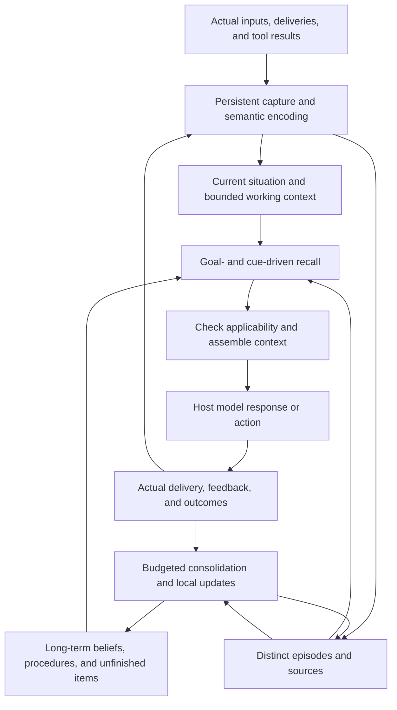

# Cognitive memory architecture implementation plan

Date: 2026-10-24. Status: design and implementation guidance. Capabilities that remain unimplemented must not be presented as delivered on the strength of this document.

The goal is for memory to participate automatically in an agent's current understanding, recall, learning, and behavioral adjustment: preserving important meaning and necessary differences, recovering episodes through cues, and revising beliefs with new evidence, all within finite context and compute budgets. Human memory provides functional inspiration; the specific data structures and algorithms remain engineering designs requiring validation.

This plan elaborates the [overall architecture](architecture.html) and [host runtime contract](autonomous-runtime.contract.json). It does not rebuild the existing foundations for persistence, identity isolation, source versions, and recovery. The product remains a memory runtime without an administration UI, accessed through SDKs, host adapters, and necessary observability interfaces. MCP provides supplementary operations.

## Implementation order and current status

First complete the loop from representation to judgment to source invalidation, then expand generalization and temporal coverage. Otherwise, more memories will amplify condition misuse and incorrect generalizations. Implementation follows these dependencies:

1. **Condition and situation core.** `ontology.py`, `temporal.py`, and `applicability.py` are implemented and connected to proposal verification, assertion persistence, current-situation restoration, recall, and context assembly. Type definitions are immutable and versioned; multivalued relations are not arbitrarily treated as mutually exclusive. Unknown validity, negative evidence, conflict, and source invalidation receive separate handling. Older free-key rules remain historically retrievable but cannot become applicable merely through free-key matching.
2. **Bounded cross-episode material selection and continuous processing.** `neighborhood.py` prioritizes the current input, finds relevant older beliefs within the permitted scope, and loads complete sources, exact parent versions, and supported relation closure. Remaining budget goes to recent context and complete episodes. Selection checks both record counts and actual proposal-request bytes; incomplete dependency bundles block long-term publication. `learning_windows.py` persists pending input intervals, processes at most eight inputs per batch with byte-based reductions, and transactionally records progress and continuation after success. Merging preserves the starting position, and retries neither expand the original snapshot nor reset budgets. Source changes trigger reconstruction of a valid window. Growing source closure, discovery of historical episodes with little lexical overlap, and actual long-term quality remain unresolved.
3. **Generalization, differences, and belief change.** Exact-sharing views preserve independent instances, complete semantics, and differences. Model-proposed, separately verified `abstracts / equivalent / exception / supersedes / contradicts` relations are also implemented, binding old and new belief versions, conditions, validity, and evidence. Generalization requires at least two instances with non-overlapping sources. Relations are stored independently, and publication does not overwrite older facts. Recall completes relation endpoints, reassesses current applicability, and assembles context by whole related groups; missing relations or sources preserve uncertainty. Deletion, correction, trusted local restoration, and persistent-plan invalidation are connected. Generalization does not authorize filling episodes with typical details, and model verification of relations is not proof of objective fact. Continuous local reassessment, scalable source boundaries, and actual generalization quality still need work.
4. **Selective forgetting and working context.** Separate access strength, stability, external utility, spacing, and interference. Complete transitions among focus, paused tasks, and items awaiting resumption. Control retention and accessibility separately, reconstructing details from existing sources rather than inventing them from typical patterns. Calibrate parameters through controlled comparisons.
5. **Complete host lifecycle and outcome evaluation.** Complete tool loops, actual streaming delivery, edits, and compaction handoff. Fix equal context and total-cost budgets for module ablations and sustained real-world evaluation. Synchronous text integration and deterministic regressions do not substitute for these acceptance checks.

Cognition providers support explicit thinking-mode configuration. Output-token and response-byte budgets are separate, and learning-outcome classifications and window progress are retained. An empty JSON proposal is no longer interpreted as learning merely because its job is `completed`. `accepted_proposals` means proposals passed current verification, not that final publication succeeded or objective facts were certified. Organizing exact shared content adds no model calls. Belief relations reuse the existing proposal and verification requests without adding another round.

Implemented portions still have explicit boundaries: the core vocabulary is limited, and dynamic concept governance is unimplemented. The programmatic core supports evaluation at an explicit historical time, but there is no complete historical-situation reconstruction API. The temporal core can resolve “today” when given a trusted source timezone. The current host protocol lacks that trusted field, so semantic processing requires relative dates to remain unknown and rejects model-invented anchors. Small-sample diagnostics with a real provider have run; long-term quality experiments have not been completed.

Default material-selection limits are 32 sources, 32 beliefs, and 16 episodes, with at most 8 parent-dependency levels. Lexical candidates are bounded, so semantic paraphrases or distant episodes with little lexical overlap are not guaranteed to be found. Stored assertions' complete `root_event_ids` may grow through learning; exceeding the budget conservatively stops long-term publication. This mechanism must not be called unlimited historical generalization. A separate design is needed for the boundary between complete dependency metadata and material read by the model on a particular turn, while preserving correction, deletion, and counterexample propagation.

The service, Python package, and TypeScript contract all expose optional `belief_resolution` and `belief_relation_refs`. The protocol remains a draft. Third-party clients that strictly validate an older schema must update for new condition, validity, applicability, and material-block types. `008_pattern_views.sql` stores rebuildable organization views, and `009_belief_relations.sql` stores sourced belief relations. Neither rewrites all original facts or immediately calls the model again to encode history.

Organization views freeze the shared definition, each episode version and observation order, fact versions, and semantic source hashes. Content changes create a new identity rather than applying the latest definition to older instances. Reads reverify sources and episodes and attempt shared presentation only when a view is selected completely. The entire selected group enters or leaves context according to actual rendering cost. A view covers only its selected assertions, not all history or counterexamples. Paths with persistent recall plans retain complete facts for now; shared presentation will require freezing organization versions as well.

Organization limits are independent of model material selection: 64 beliefs, 16 episodes, 256 complete sources, and at most 8 parent-dependency levels. Invalidation clears view content but does not revoke independently sourced facts through organization edges. Archives omit the organization cache. Trusted local restoration rebuilds it from original facts and episodes; uploaded material cannot use a view to certify its own provenance.

## Design rationale and current gaps

The current code already provides source preservation, episode and association tables, evidence-backed semantic proposals and verification, access decay, multi-route candidate fusion, a synchronous text lifecycle, deletion propagation, and recovery. These foundations must be retained.

Early DeepSeek experiments mainly recalled original text successfully. A consolidation run without thinking mode returned no proposals, and thinking mode also encountered output limits. A new DeepSeek-V4-Pro thinking-mode run on 2026-10-24 verified basic preferences, a one-day exception and restoration after expiration, and an unknown exam-preparation condition through actual source capture, model proposal and verification, publication, recall, and context preparation. The verification protocol was corrected to require both per-citation premise judgments and a whole-proposition judgment, with relation verdicts no longer optional. See the [evaluation report](../evaluations/deepseek-2026-10-24.md) for actual failures and usage.

That evaluation also exposed problems that passing unit tests cannot hide. With only three semantic beliefs and two change relations, repeated evidence structures exhausted the conservative 48,000-unit recall budget and left relation endpoints missing. Increasing the read budget in a free replay produced the correct date and direction for durable supersession but did not solve the efficiency issue. This established the need for a compact model-facing context representation: present each source and relation group once, retain inspectable evidence through stable references, and continue treating related memory groups as complete budget units. Output must not be shortened by silently cutting conditions, sources, or relations. Original historical statements also need explicit separation from currently usable rules so they cannot bypass semantic versions' temporal applicability.

Subsequent implementation connected a unified model projection in `context_views.py`. Sources, relations, and memory versions have separate reference tables, while complete verification material remains on the server. SDKs, MCP, and the active recall controller share the corresponding format. HTTP `RecallResult.belief_relations` stores each relation once, with entries connected through version references. Budgets measure actual rendered text, related groups are retained atomically, and literal episodes are explicitly labeled historical reports. Both structured generation and acceptance validation of new conditions reject legacy `eq/ne`; uninterpreted concepts use actual `unresolved` nodes, while historical reads remain compatible.

`consolidation_planning.py` plans at most three independent-instance comparison targets on top of bounded material selection and includes the plan in persistent snapshots and request-byte budgets. Target identity binds exact versions, sources, and qualifications rather than a new reminder. Deduplication queries completed jobs only for targets with valid completed verification or a valid no-change declaration. Transient failures and missing verification remain retryable, and foreground orient does not take on generalization targets. The model reports a proposal or no change for each target; only a verified `abstracts` relation can satisfy a generalization target. Unattempted targets, unverified generalizations, and model no-change declarations are reported separately. Recording a reminder does not count as shared understanding. v3 planning retains at most two strong lexical targets and one weak-cue exploration target with intersecting content words; without weak candidates, three strong targets are permitted. Deduplication precedes ranking and selection, and zero-overlap candidates remain excluded. The comparison strategy is part of target identity, so a strategy upgrade can retry an old instance group once, while repeated reminders under the same strategy remain deduplicated. Older frozen v1/v2 snapshots are verified under their original algorithm. Generalizations express only a minimal shared proposition. The runtime computes corresponding support citations for each instance, and verification separately judges every instance, the complete proposition, and the relation. Missing information cannot prove sameness or difference. Ordinary parent-dependency rules are not relaxed. Only structurally validated abstraction relations permit a shared proposition to omit irrelevant parent citations; the relation still carries complete endpoint sources. Verification may explicitly identify fragments unrelated to any substantive part of the proposition and provide exact support indices. The runtime removes only those citations from the shared proposition and revalidates each instance's remaining support and the complete relation, leaving the conclusion's text unchanged. Unknown evidence and counterevidence cannot be discarded this way, and ordinary propositions cannot use this path. Original citations and structured verdicts remain in the audit. Current candidate discovery still depends on lexical cues; this is not autonomous semantic discovery over all history.

The subsequent [compact-context and proactive-generalization report](../evaluations/deepseek-2026-10-24-compact-planning.md) records free replay of a complete temporal relation group under an 8,000-unit budget, along with real-model stages that did not all pass. v2 could proactively compare older instances, but one proposal treated unknown duration as a difference in duration. Whole-proposition verification returned unknown and blocked publication. Further work must distinguish shared propositions, observed differences, and unknown details before evaluating bounded revision; lowering the verification threshold to obtain a pass is not acceptable.

The subsequent [source-bridge and generalization repair evaluation](../evaluations/deepseek-2026-10-24-memory-repairs.md) recovered a missed English belief through zero-call replay. A two-call follow-up with an independent cognition processor also passed per-instance, whole-proposition, relation, and support-selection checks. The first failure remains recorded, without retroactively changing an unknown verdict to irrelevant. This test did not publish the real-model proposal into the database or verify the host's final answer.

The subsequent [complete synchronous conversation diagnostic](../evaluations/deepseek-2026-10-24-conversation.md) covered final answers from a real main model, the local HTTP API, persistent publication, and actual local delivery. After reconstructing the runtime, changing conversations, and disabling recent-dialogue context, historical semantic beliefs and original user support did reach the main model. The empty-brain control did not guess the material. However, situation understanding or episode organization remained partially complete in several stages. One answer agreed with its source facts but described an arrangement labeled unknown by the runtime as “currently valid.” The overall acceptance result cannot be marked as passed.

That evaluation identified an omission in the claim-time protocol: old nullable dates were supplied, but `valid_during` could be omitted and was filled as unknown only after verification. New proposals now require an explicit temporal structure and present the final interval before verification; older records and frozen parent snapshots are not backfilled. Default lexical recall now also uses the evidence boundary preceding the current input. Model context omits the diagnostic-only evaluation time, keeping semantically identical recovery requests stable while actual changes in effect or expiration still block recovery.

The historical boundary retains instruction sources for verified user preferences, such as “Please keep your answers brief.” It requires a previously received user message, a complete fragment, and valid semantic-verification status. Ordinary instructions are not automatically facts, and question presuppositions or current inputs receive no exemption. The independent temporal follow-up accepted the complete preference with an explicit start and open endpoint, but an additional episode grouping was still rejected, leaving the processor partially complete. That follow-up did not rerun the full host conversation.

Current requests now have a separate evidence use: `current_request` is bound by the server to the current input of an actual turn and can form only a current goal or question to answer. Verification separately judges the request itself, the complete proposition, and every source. Publication and recovery recheck the original verdicts and binding. A question's presuppositions cannot become historical facts through this mechanism. Long-term consolidation cannot acquire this authority, nor can it create environmental observations. Older snapshots retain their original permissions. A retained request entering a later workspace is explicitly demoted to earlier request context.

Episode organization now requires `organization_statement` and complete transition-verification context. Continuing, closing, reopening, or splitting an existing episode must present complete sources for old and new members and the exact older version before judging the organization proposition and boundary. Each episode proposal's combined old/new member source closure is limited to 32 sources; an incomplete closure rejects the proposal. This verifies how interaction records are organized, without turning their questions, quotations, or assumptions into external facts. The organization proposition describes the whole transition and must not be mistaken for a conclusion independently true of every subgroup after a split.

Model-facing consumption now consistently preserves belief disputes and applicability. Content with counterevidence, uncertainty, or conflict cannot be labeled a directly usable current rule. The synchronous host adds a fixed interpretation protocol after its original instructions, distinguishing source statements, historical reports, and currently applicable rules. The protocol counts toward the budget and generation fingerprint. These constraints still require real-model acceptance tests; the existence of a prompt does not guarantee host compliance.

The [current-request and memory-consumption evaluation](../evaluations/deepseek-2026-10-24-interaction-repair.md) reran five real-model turns. All workflow checks passed for 3/5 stages. Current requests from all three question turns reached the host accurately, and two long-term preferences and episodes were actually published. Remaining rejections involved a statement mislabeled as a request and an organization proposition adding uncited details. The host also ignored current source text and invented dates. The v2 protocol fixed those two samples in a fixed three-case comparison, but the unknown-applicability sample still called the newest record the current arrangement. The original independent uncertainty diagnostic had also reached its output limit. All failures remain recorded. The final local regression run passed 2,010 tests; real semantic acceptance did not fully pass. Publication was initially held after review; the user later explicitly requested committing the implementation with its failure reports, preserving the original verdicts.

These gaps have entered implementation. New foreground `orient-v1` uses dedicated proposal and verification formats and handles only the current situation, leaving long-term beliefs, episodes, and relations to the background. Empty situations are allowed. Recovery uses frozen sources, workspace, and mode; actual workspace version changes still invalidate older jobs. Older snapshots without a mode retain their original contract. Material selection still preserves complete source dependencies and the original conservative budgets, so a shorter schema alone does not establish that latency is solved.

The synchronous host now has an optional `AnswerReviewer`. After persisting the original draft, it reserves a single verification call and independently checks the complete answer's sources, applicability, and uncertainty. The server binds permission to the exact draft, generation context, and policy. Unknown, rejected, failed, or interrupted reviews do not permit delivery, and recovery does not automatically pay for another call. Context is checked again after review; changes in temporal applicability can also block delivery. Review neither modifies original memories nor automatically rewrites answers. A model's claim of complete coverage is not provable semantic correctness. Error interception, false rejection of valid answers, and added latency still require evaluation; higher silence or rejection rates must not be described as better memory quality. Foreground provider time in the original five-turn run was roughly 41–159 seconds. Those are pre-change configuration measurements, not evidence that the new path is faster.

The previous [answer-review and foreground-work evaluation](../evaluations/deepseek-2026-10-24-answer-review.md) completed six known regressions, a chain that stopped on turn three, and a five-turn follow-up, totaling 44 calls and 302,914 tokens. The fixed regressions behaved as expected in 6/6 cases. The initial chain exposed ambiguity between conversational acknowledgment and completed storage in “I've noted that.” Host protocol v3 clarified that completion must not be claimed without a receipt. All five answers in the single follow-up were source-consistent and delivered, but two statement turns were still mislabeled as requests and rejected by verification, leaving only 3/5 complete-flow passes. Background preferences and supersession relations were published correctly. Foreground provider time was approximately 31–78 seconds; classification reliability and conversation latency remained unresolved. Original failures are unchanged. Committing was temporarily held at the end of that batch; subsequent work and delivery are documented in the on-demand routing report.

These remain synthetic small-sample diagnostics. There is no conclusion about long-term operation, real-user conversation, or generalized final-answer quality. Job completion, valid JSON, and fluent final answers cannot replace acceptance evaluation of learning outcomes.

The user has authorized increased usage for longer real-model tests. Further work should first repair the consumption and foreground-responsibility issues above, then rerun the complete synchronous conversation chain. A separate long-history experiment should freeze cases, metrics, and budgets without overwriting old failures or resetting old ledgers. Start with a hundred-turn history, then expand to a thousand turns based on findings. Cover interference among similar episodes, spaced reminders, preference changes and exceptions, vague cues, false presuppositions, corrections and deletion, restarts, and resumption of paused tasks. Report simulated timespans separately from actual operation across days. Controls include no memory, rolling summaries, and the current memory core under the same host model, context cap, and total-call budget. Meter retrieval success, unsupported recall, applicability misuse, background learning, context cost, latency, and actual tokens separately. Retain cases not used in debugging to test generalization. On reaching predefined stop conditions, analyze first rather than repeatedly paying to obtain a pass. These are pending evaluation plans; current small samples cannot substitute for them.

The hundred-turn runner now has frozen history, a unified paid-call ledger, wiring for three groups, and archive-isolated probes, but a real long run has not been completed. The next engineering prerequisite is to preflight cognition budget against the database rolling window before starting a whole turn. A history-learning turn needs available capacity for up to four calls and 393,216 input bytes. If insufficient, save a waiting state before creating a turn or acquiring a lease, retain the same brain, directory, history, and ledger, and wait for natural expiration. Preflight cannot replace the server's final reservation. Continuation should be allowed only at committed turn boundaries or from a waiting state. Unknown costs, unconfirmed delivery, or changes to code or plan must block continuation. A partially completed two-stage task must not be charged again as a fresh task. This waiting and continuation behavior is not implemented; the existing `--resume` remains strictly read-only.

Before the long run, also freeze a small three-group comparison with two real history turns and two isolated probes, capped at 38 calls and 352,256 reserved output tokens, to verify summary provenance, no-memory-group isolation, and recovery across reconstruction. The currently planned three-group run of 104 turns plus six probes has an aggregate cap of 1,192 calls and 11,493,376 reserved output tokens. Equal fair caps do not imply equal actual spending, and unused allowance must not move between groups. The execution deadline must also be frozen. Completion cannot be accelerated by changing timestamps, switching brains, or relaxing hourly limits. These quantities are resource ceilings in the existing plan, not incurred usage, and do not guarantee coverage of actual long-term quality.

Evaluation after connecting compact representation and the planner exposed two further material-selection limits. When one episode is split into small facts, short clothing descriptions more easily meet the lexical comparison threshold than longer action descriptions. When Chinese sources yield English propositions, Chinese cues may retrieve only the source and miss the corresponding semantic belief. Each batch now has at most one weak-lexical exploration slot, and a bounded bridge connects lexical hits on supporting source fragments to semantic assertions. Versions, hashes, access scope, operation scope, and complete dependencies must still be valid. Further work must improve comparison granularity by source or episode and evaluate optional semantic retrieval. Counterexample tests need to cover cross-language inputs, different splitting granularities, and unrelated instances, without special rules for a particular test word. Current fixed comparison targets and verification constraints do not solve these discovery problems.

The specific pre-implementation limitations below motivated the proposed changes; their current progress is described above:

- `LearningEngine._snapshot()` primarily read the latest 24 sources in one conversation, with older beliefs also required to have sources inside that window. It could not support generalization across distant episodes.
- Conditions and situations used model-generated free-form keys and values without shared semantic definitions. Retrieval filtered only candidates whose conditions were false, allowing unknown conditions into answer material.
- `dynamics.py` mainly calculates access weights from representation type, age, and external feedback. It still lacks separate spacing, similarity-interference, and competition mechanisms.
- `expand_schema_residual()` originally had only pure-function expansion checks. Independent storage and read paths have now been added, but actual semantic abstraction, long-term learning quality, and context savings at scale still require evaluation.
- Automatic host integration currently mainly covers synchronous text. Tool loops, streaming delivery, message edits, and compaction handoff remain incomplete.

## One core, two learning speeds, multiple timescales

Retain the modular service, independent worker, and PostgreSQL as authoritative storage. Episodes, propositions, relations, and dynamic state share versioning and permissions. Vector and search indexes are rebuildable views, not additional sources of fact. Keep the current deployment unless evidence establishes a need for separate microservices or a dedicated graph database.



The fast path makes current events immediately usable; the slow path compares episodes, retains counterexamples, and forms reusable beliefs. Fast and slow describe processing modes rather than forcing all semantic memory to learn slowly. An explicitly expressed preference can form from one statement, while a general rule inferred from multiple experiences requires additional support.

## Shared semantic representation

The smallest memory unit is a contextualized proposition, not an isolated keyword. Preserve speaker, subject, relation, object, negation, statement type, actual or hypothetical world, valid time, and evidence location. Keywords and vectors help find propositions but cannot establish relations themselves.

Add the following logical objects to existing assertions and working state. Contracts and access patterns determine the actual SQL tables and indexes:

| Object | Required information |
| --- | --- |
| PredicateDefinition | Stable concept ID, namespace, type, value domain, applicable subject, version, and aliases |
| MemoryClaim | Subject, predicate, value, negation, conditions, valid time, sources, and statement type |
| ContextObservation | Current situation value, source, applicable subject, valid scope, and direct-report or inference status |
| Episode | Episode identity, participants, goal, time range, member versions, and revisable boundaries |
| MemoryRelation | Typed association, direction, applicable scope, evidence, and version |
| MemoryDynamics | Stability, access history, utility, interference statistics, and policy version |
| LearningOutcome | Processing coverage, outputs, rejection or no-change reasons, incomplete portions, and resource use |

Predicates and situations must use the same versioned concept registry. Core types cover people, activities, tasks, time, relationships, needs, and outcomes; domain extensions have separate namespaces. Models may propose new concepts but cannot merge different subjects, meanings, or types based on string similarity. Failed normalization preserves uncertainty and original text rather than falling back to unconditional applicability.

New predicates use an open-world assumption by default, with explicit single-value or multivalue definitions and exclusivity constraints. “Working” does not automatically negate “preparing for exams,” and no record of fatigue does not mean explicitly not tired. A condition can be deemed false only through explicit negation or a declared and satisfied exclusivity constraint. Conditions, subjects, time, and exception targets bind evidence separately. Resolving “this exception” must retain dependencies on the earlier text it refers to.

Encoding requests provide stable fragment references to the model. The model selects references and proposes propositions; code generates exact versions, source spans, and hashes, reducing failures from copying long IDs or counting Chinese characters. Deterministic checks validate structure, scope, and reference legality. Semantic support still requires verification; an existing citation is not automatically correct.

Conditions cannot establish themselves. “Prefers chatting first when preparing for exams” supports a conditional preference, not “the user is currently preparing for exams.” The rule being considered, an assistant restatement, or internal replay must not generate the situation facts that make that rule applicable. Situation observations require sources independent of the current rule application.

## Conditions, time, and change

Judge separately whether a memory can be recalled and whether a belief can be used now. A candidate may be relevant to a question, but an unknown condition must prevent treating it as a currently valid preference or basis for action. Context packets explicitly distinguish applicable beliefs, candidates awaiting confirmation, conflicts, and historical material.

Condition expressions retain three-valued `true / false / unknown` semantics. Conflicting valid sources for the same condition produce a separate conflict state rather than being silently hidden as unknown or false. A missing condition cannot become false. Unconditional `always` must come from explicit expression or a verified interpretation, not serve as the default for a condition omitted by the model.

Running example:

```text
Long-term preference
  Subject: user A
  Condition: preparing for exams, in the evening
  Content: chat for ten minutes, then plan revision

Temporary exception
  Subject: user A
  Relation: overrides the preference within a limited scope
  Scope: today, as explicitly anchored by the source
  Content: no revision today, only quiet conversation

Later change
  Content: starting next week, revise before chatting
  Relation: supersedes the previous arrangement from an explicit effective time
```

Today's exception does not overwrite the long-term preference. After today, it stops applying but remains historical experience. Once the future preference takes effect, the old preference can still answer “What did we used to do?” Dates are interpreted from source time, timezone, and original wording. If the day meant by “today” cannot be determined, it remains unresolved rather than being extended indefinitely.

The temporal model distinguishes system observation time, the described event's occurrence time, and belief validity. Validity supports explicit intervals, timezone-aware recurrence rules, relative expressions with source anchors, and unresolved states. Unknown and unbounded endpoints must not both be represented by `null`. Importing an old conversation must not treat the import date as “today” in its original wording, and local day boundaries cannot always be calculated as 24 hours. Expired factual applicability, stale current state, and reduced memory accessibility use different states rather than sharing one TTL.

Three kinds of change use different operations. Temporary exceptions use `exception`; actual habit changes use `supersedes` with an explicit absolute start. Conclusions are retracted when a past statement is acknowledged as wrong or its source is corrected. The existing correction path invalidates related lineage and cannot directly represent every habit change. `contradicts` preserves unresolved conflicts instead of simply adopting the latest statement. The old rule leaves current use only when both the relation and new belief are explicitly applicable. The old rule is reassessed when the relation expires. Relation lookup is capped at 32 edges, 128 belief versions, 256 sources, and eight parent-dependency levels; exceeding a cap must not masquerade as absence of a relation.

An explicit current request takes precedence over inferred long-term conversational habits within its authorized scope. Neither beliefs nor procedural memories can elevate host permissions or automatically authorize external actions.

## Bounded working context and resumable state

The current working context holds the turn's goals, person references, necessary constraints, active evidence, unresolved questions, and tool state. Paused tasks retain resumption cues, progress, source versions, and validity outside the active token space. Relevant cues trigger validity checks before restoration.

Working context is organized by task boundaries and dependencies, not merely clipped to the latest six messages. Necessary tool-call/result pairs, negations, cancellations, and current-task constraints must not be displaced by ordinary conversation. When capacity is insufficient, reduce unrelated material or return partial state rather than truncating content in a way that changes its meaning.

The foreground path decides whether model interpretation is needed from changes in input. When existing situation state remains valid and references are clear, reuse version-checked state. New goals, ambiguities, contradictions, or important gaps trigger understanding and recall. Do not turn every turn into a fixed sequence of multiple complete proposals and verifications.

The current input can change the situation, supply information, and trigger recall. Its question presuppositions cannot prove something happened before the question. A user's childhood account is stored as a user-reported past, not as the agent's own childhood experience.

## Episode organization and preserving differences

Propose episode boundaries from changes in goals, people, setting, time, and actual outcomes. Boundaries may overlap, nest, and change. Input capture does not wait for boundary decisions. Similarity discovers relations but cannot merge two similar experiences into one event. Only identity evidence such as stable source IDs can directly deduplicate them.

An episode may have semantic anchors, an outline, important fragments, and source-text references. Different representations share proposition provenance and explicitly retain which details they do not cover. An important concrete scene may remain accessible for a long time; a generalization is not necessarily more important than a detail.

Schemas formed across episodes retain shared patterns and each instance's differences. For example, several study sessions may share a “talk first, then plan” procedure, while a cancellation, different participant, or failed outcome must remain in the relevant instance. Expansion may recover only source-backed content of that instance, never fill unobserved details from typical schema components.

Emotion is recorded only as explicit expression or an inference with uncertainty. It can help select situations, encode importance, and provide recall cues. It does not directly establish facts, automatically create permanent personality labels, or permanently raise disclosure priority on every subsequent turn.

## Cross-episode consolidation and selective replay

Replace recent-window summarization with budgeted sampling of relevant evidence. Jobs are triggered by new sources, changed goals, failed procedures, counterexamples, or corrections. They select relevant earlier episodes for the same subject and concept, along with representative supporting and opposing instances. The recent window still provides local context but is no longer the sole evidence boundary.

Maintain encoding and consolidation watermarks, pending reasons, and cursors for sources so older events are not permanently missed after leaving the window. Process clusters exceeding one job's budget in batches and persist uncovered ranges. Do not publish supposedly complete generalizations while counterexamples or parent sources are missing.

Slow learning compares independent episodes and proposes rules, applicability boundaries, procedures, and exceptions. Restatements of the same source, duplicate messages, summaries, and summaries of summaries share one evidence lineage and do not count as independent observations. Direct reports, inferred rules, and actual tool results retain distinct evidentiary eligibility.

Background scheduling considers current and resumable goals, contradictions that could change later judgments, user-declared importance, unfinished commitments, source novelty, and processing cost. Use local candidate indexes and limited exploration rather than requiring complete historical understanding before calculating priority. Do not repeatedly call models to resummarize unchanged material.

Separate execution status from learning outcome. Valid no-change results include “an equivalent belief already exists,” “nothing generalizable,” and “more evidence needed.” Empty proposals without an account of coverage do not count as successful learning. A model's no-change reason also requires checking. Unsupported content must not be forced into memory to raise output rates.

Every publication uses source snapshots, exact parent versions, and dependency-generation checks. Corrections and deletions first block further use of old derived conclusions, then rebuild asynchronously. Model requests remain outside database transactions. Rebuilding must not bypass existing isolation, idempotency, or deletion constraints.

Snapshots must also freeze concept definitions, situation frames, temporal anchors and parsing configuration, and overriding-relation versions. Caching, generation, publication, and recovery validate these dependencies. Unchanged source text does not imply unchanged concept mapping or current applicability; checking only existing event hashes is insufficient.

## Accessibility, stability, and forgetting

Maintain these dimensions separately rather than collapsing them into one importance score:

- Stability: the engineering state of a representation's continued usability under time and interference.
- Current accessibility: whether it can enter working context given the goal, cues, and competing candidates.
- Utility: whether the memory helped an actual task or met an explicit need.
- Evidence state: source type, versions, support, counterexamples, and conflict.
- Applicability scope: people, conditions, world type, and valid time.
- Detail availability: whether source text, fragments, and indexes still exist and can be accessed.

Extend current time decay with observable histories of spaced use, situation changes, and interference from similar memories. Initial rules should remain interpretable and replaceable. Fixed half-lives must not be labeled human-brain parameters, and no curve should be declared optimal in advance. Select parameters on an independent calibration set and record the policy version with results.

Source-backed use and external outcomes in real situations may influence stability, maintenance intervals, or utility estimates. Confirming the same source is not independent confirmation of a fact about the world. Internal retrieval may temporarily activate working context and index caches, but by default adds no long-term evidentiary support and cannot indefinitely prolong retention through repeated self-reading. Replay, answer citations, user confirmations, and tool results are counted separately and deduplicated.

When similar episodes increase retrieval competition, first distinguish them through time, participants, and unique details rather than forcibly deleting a competitor. Old details may leave routine indexes or working context, while explicit cues can still directly access deeper sources without first matching a generalization that may omit them.

Cognitive fading, index demotion, and actual deletion remain separate. User sources are not automatically deleted by default. Permanent retention depends on storage and backup policies, not access decay. After actual deletion, generalizations, vectors, relations, caches, and recovery archives must not reconstruct deleted content.

## Cue-driven recall and reconstruction

Recall proceeds on demand: identify the gap, constrain permissions and the historical cutoff, combine lexical, semantic, entity, temporal, and event candidates, expand within bounds along typed relations, verify sources and applicability, and select the smallest sufficient evidence set.

Relevant negations, cancellations, temporary exceptions, and later changes to a selected belief must be searched together. They are necessary to interpret that belief and must not fall outside the budget merely because of lower lexical similarity. Insufficient capacity must explicitly leave current applicability unconfirmed rather than retaining only a shorter, incorrect conclusion.

Applicability uses the target situation and time indicated by the question. Not currently preparing for exams may prevent applying an exam-preparation preference, but must not filter the historical answer to “What did I like while preparing for exams?” Each judgment retains situation sources, satisfied and unresolved conditions, and effective exceptions for audit without storing hidden model reasoning.

Current actions, historical queries, and future plans explicitly carry different target situations and evaluation times. Future conditions that have not occurred support only conditional plans, not situations already established or episodes already completed.

Recall material can be classified as currently applicable, historically relevant, requiring confirmation, conflicting, or insufficiently sourced. Continued search depends on new evidence and the ability to distinguish candidates. Stop when repeating a query yields no new information. Report no match, processing failure, budget stop, and deletion separately rather than labeling them all forgetting. `no_match` is not proof that an event did not occur.

Successful cue-driven recovery counts only new details absent from the prompt and supported by sources preceding the question. For example, “that ginkgo tree” may help recover a school name, but the ginkgo tree supplied in the cue cannot itself count as evidence of system recall. Reconstruction may reorganize wording but cannot add typical, unsourced scene details.

Reliable new evidence, conflicting interpretations, or failed procedures trigger targeted reassessment and new versions of affected beliefs. Recall itself does not automatically rewrite the past or replace history with a single new interpretation.

## Procedures, unfinished items, and long-term continuity

Procedural memory records goals, preconditions, steps, environment versions, successful and failed outcomes, and exit conditions. Saying “this method should work” does not establish a verified procedure. Environment changes and new failures trigger applicability review.

Prospective memory records commitments, trigger conditions, deadlines, and incomplete status. Expiration and cancellation must affect current behavior; infrequent mention does not automatically invalidate a commitment. It proposes reminders or processing needs to the host, while external scheduling and action remain governed by host authorization.

Stable identity, relationships, and capability beliefs use the same source and update rules. Recovery across models preserves these verifiable states. Conversational style and specific model capabilities are tested separately. Continuity must not be manufactured by inventing fixed personality labels without evidence.

## Integration, budgets, and observability

A complete adapter must provide actual messages and edits, tool results, context control before each relevant reasoning step, delivery and cancellation, pre-compaction checkpoints, recovery, and branch identities. The automatic lifecycle must still work when memory tools are disabled. Pure MCP integration or merely replacing an API URL must report reduced capabilities rather than claim complete integration.

The model adapter explicitly declares JSON support, thinking configuration, input/output token limits, timeouts, and response sizes. Correct interfaces that conflate tokens with bytes. Record output truncation, invalid structures, lack of valid proposals, and verification failure separately. Repair requests must remain within explicit budgets rather than retrying until the desired answer appears.

Foreground and background work share a traceable cost ledger that separately retains call reservations, actual usage returned by providers, and unknown costs. Adapters must also report independent recall-controller and host-main-model calls; otherwise, explicitly state the billing coverage. Hard call and context caps can be enforced directly. Monetary limits can be guaranteed only when pricing and usage information are sufficient.

Observability interfaces add effective learning output, semantic coverage and backlog, unresolved or conflicting conditions, sampling of older sources, repeated queries without benefit, evidence invalidation, detail expansion, and reasons for degradation. Each can be associated with policy and source versions. By default, record identifiers and statistics without copying conversation bodies, credentials, or hidden reasoning.

## Implementation dependencies in the existing codebase

The sequence below follows dependencies; completing its first portion does not constitute a complete product. Evaluation fixtures and result records accompany every step.

| Work | Main implementation locations | Completion evidence |
| --- | --- | --- |
| Semantic types, conditions, and temporal contracts | New semantic-definition and situation modules; extended contracts, `semantic.py`, `cognition.py` | The same predicate stays consistent across stages; unknown is not treated as applicable; exceptions and habit changes remain separate |
| Effective encoding and current working context | `semantic.py`, `learning.py`, `runtime.py` | Code generates references; empty results are classifiable; pause/resume and expiration behave correctly |
| Cross-episode selection and slow learning | `learning.py`, `consolidation.py`, persistent jobs and indexes | Distant support and counterexamples both participate; window movement does not omit older events |
| Event differences, schemas, and local updates | Episode and association tables and derived views | Similar events remain distinct; generalizations preserve differences; new evidence updates only affected beliefs |
| Dynamic accessibility and cue-based expansion | `dynamics.py`, `retrieval.py`, `recall_control.py` | Explicit cues recover genuinely new details; time, interference, and spacing are separately measurable |
| General host lifecycle and cost | Python runtime, TypeScript SDK, adapters, and monitoring | Automatic operation without memory tools; streaming, tool loops, compaction, and recovery satisfy the contract |

Database changes use additive fields and versioned objects. Older sources retain their original IDs and revision numbers. Older assertions initially remain historically retrievable; legacy `always` or missing fields do not upgrade them into currently usable conclusions. Queue records needing reinterpretation and rebuild incrementally within budgets rather than immediately calling paid models over the entire history.

New concepts, aliases, relations, temporal anchors, and current situations also participate in source dependencies, archives, and deletion propagation. User content must not be distilled into permanent metadata that cannot be deleted. Semantic versioning and capability declarations support client compatibility. Older clients must not silently drop new conditions or unknown states; inability to represent them requires explicit degradation.

Compare new policies against old ones on fixed historical snapshots and isolated derived views without updating production feedback counters. Switch by brain and policy version, with rollback available for derived views. Deletion generations, retracted facts, and actual delivery records must not be undone by a policy rollback.

## Behavioral acceptance

Create an independent ground-truth ledger recording propositions, original sources, subjects, time, conditions, and permitted inferences. The system's own stored memories must not serve as that ledger. Different prompts on the same history use independent snapshots so one question cannot contaminate the next question's historical evidence.

| Scenario | Required observed behavior |
| --- | --- |
| Exam-preparation preference and today's exception | Correct arrangements on an ordinary exam-preparation evening, the exception day, the following day, and after exams |
| Old and new habits | Separate answers for past and present; normal change does not imply that old episodes never happened |
| Self-establishing conditions and historical situations | A conditional preference does not prove its condition currently holds; exam-preparation preferences remain recallable after exams without being applied to the present |
| Primary-school name and ginkgo tree | Ordinary questions retrieve relevant generalizations; a real additional cue recovers details absent from the prompt |
| Two similar commitments | The same people and place with different dates or outcomes do not become one event |
| Generalization from dispersed episodes | Support and counterexamples far outside one window jointly determine a rule's scope |
| Generalization and restoration of differences | Preserve negation, conditions, people, time, and exceptions without inventing typical details |
| Pause and resume | Recover goals and unfinished steps while recognizing cancelled or expired items |
| Misleading prompts and repeated agreement | Questions, assistant restatements, and internal replay do not fabricate independent historical evidence |
| New evidence and deletion | Invalidated beliefs do not enter new answers; archive restoration does not resurrect deleted content |
| Automatic integration | State can recover according to declared capabilities after closing the UI, disabling memory tools, restarting, or changing models |

Measure encoding quality, condition applicability, evidence recall, answer consumption, update effects, integration behavior, and resource use separately. Refusal alone must not yield a high score. Report both answer coverage when evidence exists and false-recall rates when it does not.

Controls include a recent window, rolling summary plus recent window, conventional RAG with the same source filtering, the current deterministic path, and per-module ablations of the complete architecture. Compare both equal final-context budgets and equal total-cost budgets. Total cost includes writing, verification, embedding, background work, retrieval, answering, and failed requests.

Temporal experiments vary calendar age, conversation count, and similarity interference independently. Virtual clocks test expiration and policies, not actual quality over years. Report sustained weekly/monthly operation separately. Split data into training, calibration, and hidden test sets by complete histories, and freeze evaluation rules before examining results.

Fixed acceptance fixtures require zero permission violations, resurrection of deleted content, future-information leakage, publication after source invalidation, duplicate side effects, and hard-budget overruns. Evaluate semantic quality on independent samples with uncertainty intervals. Half-lives, trigger thresholds, sampling sizes, and model-call policies all need calibration rather than direct numerical copying from neuroscience papers.

This plan itself does not trigger new paid-model evaluations or add automatic CI. Real-model experiments after implementation use predefined call and cost budgets; ordinary regressions run locally first.

The current latency implementation uses explicit `always` / `on_demand` policies. On-demand routing uses structured dependencies from the current retrieval to decide whether foreground situation reasoning is needed. It retains full analysis for conditions, goals, unfinished items, and incomplete closures. Skipping means only that no derived situation is generated for the turn, not successful verification. Dependencies are rechecked transactionally before preparation and generation, covering the interval where background beliefs have been published but the version counter has not changed. Answer review and asynchronous learning remain independent. Delivering the original input to the host does not mean an immediate working goal has formed. Complete task-oriented memory still uses `always`; latency improvements for simple recall must not be extrapolated to every agent task.

The [on-demand routing evaluation](../evaluations/deepseek-2026-10-24-orientation-routing.md) delivered five source-consistent answers, with 4/5 complete-flow passes. Foreground model waiting averaged 20.88 seconds, compared with a historical full-mode average of 56.47 seconds; this is a historical before/after comparison. A background proposal to additionally reconstruct episodes from an older conversation was correctly rejected. Versioned operation scope and learning-input labels are now complete, while preserving recovery with the older contract, empty-text handling, and exact byte budgets. A two-call processor follow-up using the original complete sources passed, which is not equivalent to rerunning and passing the entire five-turn chain. The final local run passed 2,393 Python regressions. The on-demand batch plus its targeted follow-up used 16 actual calls and 163,841 tokens; the previous batch's 44 calls are separate. Request-intent classification, answer-review latency, and prerequisites for long runs still need work.

## Future research: interactions among personality, emotion, and memory

On 2026-10-24, the user set a future direction: first complete and validate the first memory-library version, then investigate agent personality and emotion settings. This is a research scope, not a selected architecture, implemented capability, or already-started literature review. Current work remains focused on the memory core, complete host integration, and sustained-operation validation, without prematurely adding personality fields, emotion scores, or model calls.

Future research must first distinguish three objects: the agent's personality settings and potentially slow-changing tendencies, short-term emotion state that varies with context, and the effects of these states on memory processing. Whether personality may change through experience, who controls it, how state is represented, and how it recovers require research and experiments. A user's expressed emotion is a subject- and source-bound observation, not automatically the agent's own emotion. Configuration, observation, and model inference must also remain distinct.

The research goal is to test whether personality and emotion can justifiably affect attention allocation, encoding, consolidation, forgetting, and cue-driven recall, and consequently behavior, rather than only changing response tone. These are engineering hypotheses to test. Any such modulation must preserve factual provenance, uncertainty, correction, and deletion rules. Current emotion or personality tendencies cannot make one episode a permanent fact, raise evidence truthfulness, or override the user's explicit current request. Self-reinforcing biases in the interaction of emotion and recall require dedicated tests. Repeated recall adds no independent evidence, and an agent's emotional interpretation cannot establish the user's actual emotion.

Before formal design, systematically read primary research and reviews in personality psychology, affect and memory, cognitive neuroscience, and computational modeling. For each candidate mechanism, record study populations, experimental conditions, evidence strength, conflicting results, and the limits of engineering transfer, then select reproducible experiments. Evaluation should include long-term consistency, emotion recovery, adaptation across situations, memory biases, and resource costs, compared with the same memory core without these modules.

Functional inspiration from human memory and neuron-level simulation are different research objectives. Do not assume a need for spiking neural networks, biological neuron models, or a particular personality inventory. If these directions are considered later, first identify the problem they solve and their measurable benefit over existing approaches. More personality-like or emotional behavior is not sufficient evidence of implemented human neural mechanisms or subjective experience.

## Research foundations and limits of transfer

The following research supports particular mechanisms or provides computational explanations; it does not establish that this software is equivalent to a human brain. Engineering implementations must pass the behavioral and cost comparisons above.

- [Sun et al., 2023, Organizing memories for generalization in complementary learning systems](https://pmc.ncbi.nlm.nih.gov/articles/PMC10400413/): computational theory describes a tradeoff between remembering instances and extracting generalizable structure, supporting selective consolidation. It does not imply that every episode should become a generalization or that any summarizer provides equivalent capabilities.
- [Baldassano et al., 2017, Discovering Event Structure in Continuous Narrative Perception and Memory](https://www.dpmlab.org/papers/Neuron17.pdf): human neuroimaging during natural narratives supports event organization and recall associations across multiple timescales. We draw on event boundaries and situation restoration without calling fixed text chunks a brain-region mechanism.
- [Bakker et al., 2008, Pattern Separation in the Human Hippocampal CA3 and Dentate Gyrus](https://pmc.ncbi.nlm.nih.gov/articles/PMC2829853/): human fMRI found activity patterns consistent with distinguishing similar experiences. This inspires preservation of instance differences; similarity thresholds and deduplication rules remain engineering choices.
- [Cepeda et al., 2008, Spacing Effects in Learning](https://www.evullab.org/pdf/CepedaVulRohrerWixtedPashler-PS-2008.pdf): human behavioral experiments link review spacing to the desired retention interval. We propose separate stability and accessibility states, but those fields and their formulas are not mechanisms directly established by this study.
- [Sinclair and Barense, 2018, Surprise and destabilize](https://barense.psych.utoronto.ca/wp-content/uploads/2018/07/2018_Sinclair_LearnMem.pdf): human experiments investigate prediction error and memory updating and also observe incorporation of incorrect details. This inspires targeted reassessment triggered by new evidence, with sources and versions constraining false reconstruction.
- [Mattar and Daw, 2018, Prioritized memory access explains planning and hippocampal replay](https://www.princeton.edu/~ndaw/md18.pdf): a computational model explains replay priority through future need and potential improvement in decisions. This inspires selective scheduling; it does not supply a ready-made efficient algorithm for finding all candidates or prove that the brain directly implements its formula.
- [Rose et al., 2016, Reactivation of latent working memories with transcranial magnetic stimulation](https://doi.org/10.1126/science.aah7011): human neuroscience experiments support reactivation of information temporarily outside the focus of attention. This inspires the distinction between focused and resumable tasks, not a guarantee of lossless long-term episode retention.
