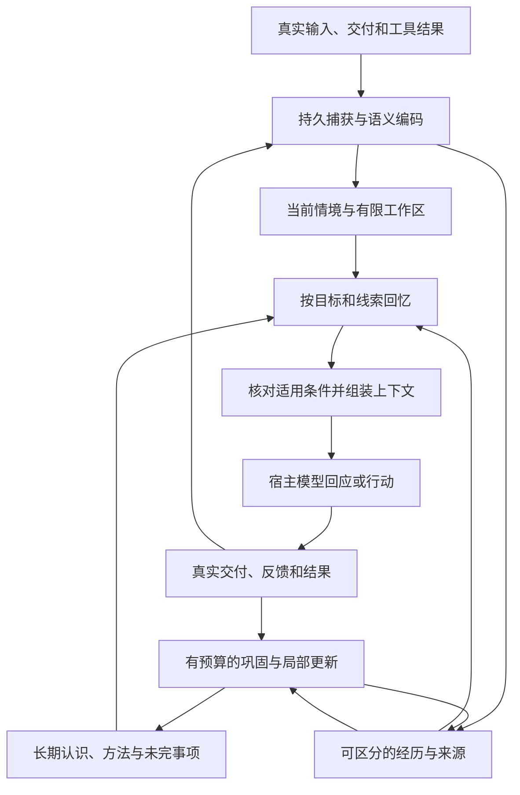

# 认知记忆架构实施计划

日期：2026-10-24。状态：设计与实施依据，尚未实现的能力不能据此标为已交付。

目标是让记忆自动参与 Agent 的当下理解、回忆、学习和行为调整：在有限上下文与计算预算内，留下重要含义、保留必要差异、用线索找回经历，并根据新证据改变认识。借鉴人类记忆的功能机制，具体数据结构与算法仍是需要验证的工程设计。

本计划细化[总体架构](architecture.html)与[宿主运行契约](autonomous-runtime.contract.json)，不重新搭建已有的持久化、身份隔离、来源版本和恢复基础。产品继续采用无管理页面的记忆运行时，通过 SDK、宿主适配器和必要的观测接口使用；MCP 提供补充操作。

## 实施顺序与当前落地

先打通“表示—判断—来源失效”闭环，再扩大归纳能力和时间跨度。否则更多记忆只会放大条件误用与错误概括。按依赖推进如下：

1. **条件与情境内核。** 已实现 `ontology.py`、`temporal.py`、`applicability.py`，并接入提议核验、断言持久化、当前情境恢复、召回与上下文组装。类型定义不可变并带版本；多值关系不擅自互斥。有效期未知、负向证据、冲突与来源失效都有独立处理。旧自由键规则保留历史检索，不能凭自由键匹配自动采用。
2. **有边界的跨经历选材与连续处理。** `neighborhood.py` 优先当前输入，查找允许范围中的相关旧认识，加载完整来源、精确父版本和有据关系闭包；剩余预算补近期上下文与完整经历。选材同时检查条数和实际提议请求字节，相关依赖包不完整时停止长期发布。`learning_windows.py` 持久保存待处理输入区间，每批最多八条并按字节预算缩批，成功后事务内记录进度并续接；合并不丢起点、重试不扩大原快照或重置额度。来源变化触发有效窗口重建。来源闭包增长、低词面重合的历史发现和真实长期质量仍待解决。
3. **概括、差异与认识变化。** 精确共享视图保留独立实例、完整语义和差异。另已实现模型提议并分别核验的 `abstracts / equivalent / exception / supersedes / contradicts` 关系，绑定新旧认识版本、条件、有效期与证据；概括至少需要两个来源不重叠的实例。关系独立存储，发布不改写旧事实。召回补齐关系端点、重新判断当前适用性，并以整个相关组组装上下文；关系或来源缺失时保持不确定。删除、更正、可信本机恢复及持久计划失效已接通。概括不授权用典型细节填补经历，模型关系核验也不是客观事实证明。持续局部重评、规模化来源边界与真实归纳效果仍需完成。
4. **选择性遗忘与工作区。** 将访问强度、稳定性、外部使用价值、间隔和干扰分开；完成焦点、暂停任务、待恢复事项的转换。保存和可达性分别控制，以已有来源重建细节，不能用典型模式补造细节。参数由对照实验校准。
5. **完整宿主生命周期与效果评估。** 完成工具循环、流式实际交付、编辑和压缩交接；固定相同上下文与总成本预算做模块消融及真实持续运行评估。同步文本接入和确定性回归不能替代这些验收。

认知提供方支持显式思考模式配置，输出 token 与响应字节预算分开，并保留学习结果分类及窗口进度。空 JSON 提议不再仅凭任务 `completed` 被解读为学到了东西；`accepted_proposals` 表示提议通过当前核验，不是最终发布成功或客观事实认证。精确共同内容组织不新增模型调用；认识关系复用原有提议与核验请求，不额外添加一轮调用。

已实现的部分仍有明确边界：核心词表有限，动态概念治理未实现；程序内核支持显式历史时刻求值，但尚无完整的历史情境重建 API。时间内核可以在提供可信来源时区时解析“今天”，当前宿主协议没有这个可信字段，因此语义处理要求相对日期保持未知，拒绝模型自造锚点。尚未做新一轮付费模型或真实长期质量实验。

默认选材上限为 32 条来源、32 条认识、16 个经历，父依赖最多 8 层；词面候选有界，不能保证语义改写、低词面重合的远期经历一定被找出。已存断言的完整 `root_event_ids` 可能随学习增加，超过预算时保守停止长期发布。不能把这套机制称为无限历史归纳；需要另行设计完整依赖元数据与本轮模型阅读内容的边界，同时保留更正、删除及反例传播。

服务、Python 包和 TypeScript 契约同步提供可选的 `belief_resolution` 与 `belief_relation_refs`。协议仍处于草案阶段；严格校验旧 schema 的第三方客户端需要更新新增条件、有效期、适用性及资料块类型。`008_pattern_views.sql` 保存可重建组织视图，`009_belief_relations.sql` 保存带来源的认识关系；两者均不全量重写原事实，也不立即重新调用模型编码历史。

组织视图冻结共同定义、每个经历版本和观察顺序、事实版本与语义来源哈希；内容变化产生新的身份，不把最新版套回旧实例。读侧重新核验来源和经历，只有完整选中视图时才尝试共享呈现；整个已选组按实际渲染开销进入或退出上下文。视图的覆盖范围只限所选断言，不能代表全部历史或全部反例。带持久回忆计划的路径暂时保留完整事实，后续需要把组织版本一起冻结后再支持共享呈现。

组织上限独立于模型选材：64 条认识、16 个经历、256 条完整来源和最多 8 层父依赖。失效会清除视图正文，但不会通过组织边连带撤销有独立来源的事实。档案不导出组织缓存；可信本机恢复从原事实和经历重建，上传内容不能靠视图自行证明来源有效。

## 设计依据与当前差距

当前代码已经具备来源保存、经历及关联表、带证据的语义提议与核验、访问衰减、多路候选融合、同步文本生命周期、删除传播与恢复。这些基础需要保留。

早期 DeepSeek 试验中，成功召回主要使用原文；一次非思考模式巩固返回空提议，思考模式也曾受输出上限影响。2026-10-24 的新一轮 DeepSeek-V4-Pro 思考模式实测，已通过真实来源捕获、模型提议与核验、发布、召回和上下文准备验证基础偏好、一天例外及其到期恢复、未知备考条件。核验协议修正为逐引文前提判定与整体命题判定同时成立，关系判定字段不再可省略。实际失败和用量见 [实测报告](../evaluations/deepseek-2026-10-24.md)。

这轮实测也暴露了不能用单元测试通过掩盖的问题：只有三条语义认识和两条变化关系，重复证据结构就能耗尽 48,000 单位的保守召回预算，使关系端点缺失。免费提高读取预算后，长期替换的日期和方向判断正确，但这不算解决效率问题。下一项优先工作应是面向模型的紧凑上下文表示：每组来源与关系只呈现一次，以稳定引用保留可展开依据，并继续把相关记忆组作为完整预算单元；不能通过静默裁掉条件、来源或关系来缩短输出。原始历史陈述还需明确与当前可采用的规则区分，避免绕开语义版本的时效判断。

目前仍是合成小样本诊断，没有长期运行、真实用户对话或最终回答质量结论。任务结束、合法 JSON、最终回答流畅，都不能替代学习效果验收。

实施前的具体限制决定以下改造；对应的当前进展见上节：

- `LearningEngine._snapshot()` 主要读取同一会话最近 24 条来源，旧认识也要求来源包含于这个窗口，不能承担跨很远经历的归纳。
- 条件与情境使用模型自由生成的键和值，缺少共同的语义定义；检索只过滤条件为假的候选，未知条件仍可能进入回答资料。
- `dynamics.py` 主要依据表示类别、年龄和外部反馈计算访问权重，尚无独立的间隔、相似干扰与竞争机制。
- `expand_schema_residual()` 原先只有纯函数展开检查。现已增加独立存储和读取链路，后续仍需真实语义抽象、长期学习质量和节省上下文的规模评估。
- 自动宿主接入目前主要覆盖同步文本；工具循环、流式交付、消息编辑和压缩交接仍需完成。

## 一套内核，两种学习速度，多个时间尺度

保持模块化服务、独立 worker 与 PostgreSQL 作为权威存储。经历、命题、关系和动态状态共享版本与权限体系；向量和搜索索引属于可重建视图，不另外成为事实来源。没有证据证明必须拆分微服务或引入独立图数据库时，沿用现有部署方式。



快速路径保证当前发生的事可立即使用，慢速路径比较不同经历、保留反例并形成可复用认识。快慢描述处理方式，不把所有语义记忆强制变成慢学习：明确表达的偏好可以单次建立；从多次经历推导的一般规律需要额外依据。

## 共同语义表示

记忆的最小单元采用带上下文的命题，而非孤立关键词。保留说话人、主体、关系、对象、否定、表达性质、现实或假设世界、有效时间和证据定位。关键词与向量只能帮助找到命题，不能自行证明关系成立。

在现有断言与工作状态上增加以下逻辑对象，具体 SQL 表与索引由契约和访问模式确定：

| 对象 | 必须表达的内容 |
| --- | --- |
| PredicateDefinition | 稳定概念 ID、命名空间、类型、值域、适用主体、版本和别名 |
| MemoryClaim | 主体、谓词、值、否定、条件、有效时间、来源和表达性质 |
| ContextObservation | 当下情境值、来源、适用主体、有效范围及直接报告或推断状态 |
| Episode | 经历身份、参与者、目标、时间范围、成员版本与可修订边界 |
| MemoryRelation | 有类型的关联、方向、适用范围、证据与版本 |
| MemoryDynamics | 稳定程度、访问历史、使用价值、干扰统计和策略版本 |
| LearningOutcome | 处理覆盖、产物、拒绝或无变化原因、未完成部分与消耗 |

谓词与情境必须使用同一个版本化概念注册表。核心类型覆盖人物、活动、任务、时间、关系、需求和结果；领域扩展有独立命名空间。模型可以提出新概念，但不能靠字符串相近自动合并不同主体、含义或类型。不能归一化时保留未知和原文，不退回无条件适用。

新谓词默认开放世界，显式定义单值或多值及互斥约束。“在工作”不能自动否定“在备考”；没有记录疲劳不等于明确不累。只有明确否定或已声明且满足的互斥约束，才能得到条件不成立。条件、主体、时间和例外指向分别绑定证据；解析“这个例外”时同时保留它所指前文的依赖。

编码请求向模型提供稳定的片段引用。模型选择引用并提出命题，程序生成精确版本、原文跨度与哈希，减少模型复制长 ID、数中文字符造成的失败。确定性检查负责结构、范围与引用合法性；语义支持仍需核验，不能因引用存在就判为正确。

条件不能自证。“备考时喜欢先聊天”只支持条件偏好，不支持“用户现在正在备考”。不得从待采用的规则、助手复述或内部回放反向生成让规则成立的情境事实；情境观察必须有独立于这次规则应用的来源依据。

## 条件、时间与变化

分别判断“这条记忆可以被回想”与“这条认识现在可以采用”。候选可能与问题有关，但条件未知时不得当作当前有效偏好或执行依据。上下文包显式区分适用认识、待确认候选、冲突及历史资料。

条件表达式保留 `true / false / unknown` 三值语义；同一条件存在相互冲突的有效来源时，另行返回冲突状态，不能用未知或假悄悄掩盖。条件缺失不能转换为 false；无条件 `always` 只能来自明确表达或经核验的解释，不能作为模型漏写条件的默认值。

贯穿例子：

```text
长期偏好
  主体：用户甲
  条件：活动为备考，且时段为晚上
  内容：先聊十分钟，再安排复习

临时例外
  主体：用户甲
  关系：在限定范围内覆盖上述偏好
  范围：来源明确指向的今天
  内容：今天不复习，只安静聊天

后续变化
  内容：从下周开始先复习再聊天
  关系：从明确生效时间起替代旧安排
```

今天的例外不改写长期偏好；过了今天，它退出当前应用，仍可作为历史经历。未来偏好生效后，旧偏好仍能用于回答“以前怎么安排”。日期按来源时间、时区和原话解析；无法确定“今天”指向哪一天时保持未解析，不能无限续期。

时间模型区分系统观察时间、所述事件发生时间和认识适用时间。适用时间支持明确区间、带时区的重复规则、带来源锚点的相对表达以及未解析状态；端点的未知与无界不能都用 `null` 表示。导入旧聊天不能把导入日期当作原话的今天，当地日界也不能固定按 24 小时计算。事实适用期结束、当前状态过旧和记忆可达性下降采用不同状态，不共用一个 TTL。

三类变化采用不同操作：临时例外由 `exception` 表达；真实习惯变化由带明确绝对起点的 `supersedes` 表达；承认过去说错或来源被更正时才撤回相应结论。现有更正路径会失效相关谱系，不能直接用它表示所有习惯变化。`contradicts` 保留未解决冲突，不简单采用最后一句。关系与新认识的适用条件都明确成立时，才使旧规则退出当前采用；关系过期后重新评估旧规则。关系查找最多 32 条边、128 个认识版本、256 条来源和八层父依赖，超限不能伪装为没有关系。

当前明确请求在其授权范围内优先于推断出的长期交流习惯。认识和程序性记忆都不能提升宿主权限或自动授权外部行动。

## 有限工作区与待恢复状态

当前工作区保存本轮目标、人物指代、必要约束、活跃证据、未决问题和工具状态。暂时搁置的任务保存恢复线索、进度、来源版本与有效期，退出当前 token 空间；再次出现相关线索时先核对有效性再恢复。

工作区由任务边界和依赖组织，不仅按“最近六条消息”截取。必要的工具调用与结果配对、否定、取消信息和当前任务约束不能被普通闲聊挤掉。容量不足时减少不相关资料或返回部分状态，不能截断到改变含义。

前台按输入变化决定是否需要模型解释。已有情境仍有效、指代明确时复用经过版本检查的状态；出现新目标、歧义、矛盾或重要缺口时再触发理解与回忆。不把每一轮固定变成多次完整提议和核验。

当前输入可以改变情境、提供新信息和触发回忆；其问题预设不能证明提问之前发生过某件事。用户讲述的童年经历记录为“用户报告的过去”，不会变成 Agent 亲历的童年。

## 经历组织与差异保留

按目标、人物、场景、时间和实际结果的变化提出经历边界。边界允许重叠、嵌套和修订；捕获输入不等待边界确定。相似度用于发现关系，不能把两次相似经历合成同一件事。只有稳定来源 ID 等身份依据可以直接去重。

同一经历可以有语义锚点、经历轮廓、重要片段与原文引用。不同表示共享命题来源，并显式保留各自没有覆盖的细节。一个重要的具体画面可以长期可达；概括不是必然比细节更重要。

跨经历形成图式时，保留共同模式与每次经历的差异。例如多次复习可以共享“先交流后规划”的程序，但某天取消、人物不同、结果失败，必须留在对应实例中。展开只能恢复该实例有来源的内容，不能用图式的常见部分补造未观察到的细节。

情绪只以明确表达或带不确定性的推断记录，可帮助选择情境、编码重要性和回忆线索。它不直接证明事实，不自动形成永久性格标签，也不等于提高今后每轮的披露优先级。

## 跨经历巩固与有选择的回放

将“最近窗口整理”改为受预算限制的相关证据采样。任务从新增来源、目标变化、方法失败、反例或更正触发，选取同主体与同概念的相关旧经历、代表性支持和反对实例。最近窗口仍提供局部语境，但不再是唯一证据范围。

为来源维护编码与巩固水位、待处理原因和游标，避免较旧事件因滑出窗口而永久漏处理。超过一次任务预算的簇分批处理，持久记录未覆盖范围；不得在缺少反例或父来源时发布声称完整的概括。

慢速学习比较多个独立经历，提出规律、适用边界、方法和例外。相同来源的复述、重复消息、摘要与摘要的摘要属于同一证据谱系，不计为独立重复观察。直接报告、推断规律、实际工具结果保持不同证据资格。

后台调度考虑当前与待恢复目标、可能改变后续判断的矛盾、用户明确的重要性、未完约定、来源新颖性和处理成本。采用局部候选索引和有限探索，不要求先全量理解历史才能计算优先级。没有变化时不反复调用模型重新总结。

把执行状态与学习结果分开。合法的无变化包括“已有等价认识”“无可泛化内容”“需要更多证据”；空提议但无法解释覆盖情况不能计为成功学习。模型给出的无变化理由也是待检查的结果。无依据内容不能为了提高产出率被强行写入。

每次发布使用来源快照、精确父版本和依赖代际检查。更正或删除先阻断旧派生结论的后续使用，再异步重建。模型请求继续放在数据库事务之外；重建不得绕过现有隔离、幂等与删除约束。

快照还必须冻结概念定义、情境帧、时间锚点与解析配置、覆盖关系的版本。缓存、生成、发布和恢复都验证这些依赖。来源文字没有改变，不代表其概念映射或当下适用性没有改变；不能只检查旧有事件哈希。

## 可达性、稳定程度与遗忘

将以下维度分开维护，不压成一个重要性分数：

- 稳定程度：这份表示在时间和干扰中保持可用的工程状态。
- 当前可达性：在此目标、线索和竞争候选下，能否被选入工作区。
- 使用价值：这条记忆是否帮助了实际任务或满足明确需求。
- 证据状态：来源性质、版本、支持、反例和冲突。
- 适用范围：人物、条件、世界类型和有效时间。
- 细节可用性：原文、片段和索引目前是否仍存在且可访问。

在现有时间衰减基础上，增加间隔使用、情境变化与相似记忆干扰的可观测历史。初始规则保持可解释与可替换；固定半衰期不标为人脑参数，也不预先宣称某种曲线最优。参数通过独立校准集选择，策略版本随结果记录。

真实场景中有来源的使用和外部结果可以影响稳定程度、维护间隔或用途估计；确认同一来源不等于确认世界事实。内部检索可临时激活工作区和索引缓存，默认不增加长期证据支持或靠循环自读无限延长保留。回放、回答引用、用户确认和工具结果分开计数并去重。

相似经历增加检索竞争时，优先利用时间、人物与独特细节区分，而不是强行删除一个竞争候选。旧细节可以退出日常索引或工作区，明确线索仍可直接访问深层来源，不要求先命中一个可能遗漏它的概括。

认知淡出、索引降级和实际删除继续分离。默认不自动删除用户来源；永久保留依赖存储与备份政策，不能由访问衰减保证。真正删除后，概括、向量、关联、缓存和恢复档案不能继续重建被删除内容。

## 线索回忆与重建

回忆流程按需执行：理解缺口，限定权限和历史截止点，组合关键词、语义、实体、时间与事件候选，沿有类型的关系有限展开，核对来源和适用条件，最后选择最小充分证据。

必须同时查找所选认识的相关否定、取消、临时例外和后续变化。它们是解释该认识所需的信息，不应仅因词面匹配较低被排在预算之外。容量不足时明确不能确认当前适用性，不能只留下更简短的错误结论。

适用性使用问题指向的目标情境与时间。现在不备考，可以阻止采用备考偏好，但不能因此过滤“我备考时喜欢什么”的历史回答。每次判断保留所用情境来源、已满足和未解决条件以及生效例外，便于审计，无需保存模型的隐藏推理。

当前行动、历史查询和未来计划显式携带不同的目标情境与判断时点。未来条件尚未发生时，只能形成条件计划，不能当作已经满足的情境或已经完成的经历。

回忆材料可分为当前适用、历史相关、需要确认、相互冲突和来源不足。继续搜索依据新增证据和候选区分能力；重复相同查询没有新增信息时停止。找不到、处理故障、预算停止和已删除分别报告，不能统称失忆，也不能把 no_match 当作事件不存在。

唤回成功只计算提示之外、由提问前来源支持的新增细节。例如“那棵银杏树”可以帮助找回校名，但不能把提示中的银杏树本身当作系统已经记起的证据。重建允许重新组织表达，不允许添加典型但无来源的场景细节。

遇到可靠的新证据、解释冲突或方法失效时，定向重评受影响的认识，并生成新版本。回忆本身不自动改写过去，也不把新解释覆盖成唯一历史。

## 方法、未完事项与长期连续性

程序性记忆记录目标、前置条件、步骤、环境版本、成功与失败结果、退出条件。仅说“这办法应该有效”不能形成已验证方法；环境变化或新失败触发适用性复核。

前瞻记忆记录约定、触发条件、截止时间与未完成状态。到期和取消都要能改变当前行为；少被提起不意味着承诺自动失效。它向宿主提出提醒或处理需求，外部调度和行动仍由宿主授权机制执行。

稳定身份、关系和能力认识也使用同一来源与更新规则。跨模型恢复保留这些可核对状态，交流风格与具体模型能力另行测试；不通过无证据生成固定人格标签制造连续性。

## 接入、预算与观测

完整适配器要提供真实消息及编辑、工具结果、每次相关推理前的上下文控制、交付和取消、压缩前 checkpoint、恢复与分支身份。记忆工具禁用时，自动生命周期仍应工作。纯 MCP 或仅替换 API URL 的接入按实际能力降级，不能标为完整接入。

模型适配层显式声明 JSON 能力、思考配置、输入与输出 token 上限、超时和响应大小。修正 token 与字节配置混用的接口表达；输出截断、结构非法、无有效提议、核验失败分别记录。修复请求只在明确预算内进行，不反复重试直到得到想要的答案。

前台与后台共享可追踪的成本账，分别保留调用预留、提供方返回的实际用量及未知费用。独立回忆控制器和宿主主模型也需要适配器上报，未能覆盖时明确计费范围。硬调用和上下文上限可直接执行，金额限制只在价格与用量信息足够时提供保证。

观测接口增加学习有效产出、语义覆盖与积压、条件未解析或冲突、旧来源采样、重复查询无收益、证据失效、细节展开和降级原因。每项能关联策略及来源版本；默认只记录标识和统计，不复制聊天正文、凭据或隐藏推理。

## 在现有程序中的实施依赖

下列顺序按依赖组织，不代表可以把前半部分宣称为完整产品。评估夹具与结果记录贯穿全部工作。

| 工作 | 主要落点 | 完成证据 |
| --- | --- | --- |
| 语义类型、条件和时间契约 | 新增语义定义与情境模块；扩展契约、`semantic.py`、`cognition.py` | 同一谓词跨阶段一致；未知不当作适用；例外与习惯变化分开 |
| 有效编码与当前工作区 | `semantic.py`、`learning.py`、`runtime.py` | 引用由程序生成；空结果可分类；暂停恢复与过期处理正确 |
| 跨经历选材与慢速学习 | `learning.py`、`consolidation.py`、持久任务与索引 | 相隔很久的支持及反例都能参与；旧事件不因窗口滑动漏处理 |
| 事件差异、图式和局部更新 | 经历、关联表与派生视图 | 相似事件不混同；概括保留差异；新证据只更新相关认识 |
| 动态可达性和线索展开 | `dynamics.py`、`retrieval.py`、`recall_control.py` | 明确线索带来真实新增细节；时间、干扰和间隔分别可测 |
| 通用宿主生命周期与成本 | Python runtime、TypeScript SDK、适配器及监控 | 无记忆工具仍自动工作；流式、工具循环、压缩与恢复通过契约 |

数据库改动采用新增字段和版本化对象的方式。旧来源保留原 ID 和修订号；旧断言先保持历史可检索，不因旧 `always` 或缺少字段就升级为当前可采用的结论。建立需要重新解释的队列，在预算内逐步重建；不全量即时调用付费模型。

新概念、别名、关系、时间锚点和当前情境也纳入来源依赖、归档及删除传播，不能把用户内容提炼成无法删除的永久元数据。协议通过语义版本与能力声明兼容客户端；旧客户端不能静默丢掉新条件或未知状态，无法表达时使用明确降级结果。

新策略先在固定历史快照和隔离的派生视图上与旧策略比较，不写回正式反馈计数。切换按大脑与策略版本进行，可回退派生视图；删除世代、撤回事实和真实交付记录不能随策略回退而撤销。

## 行为验收

建立独立真值账本，记录命题、原始来源、主体、时间、条件与允许的推断。账本不能由被测系统已经写出的记忆反过来充当。相同历史上的不同提示测试使用独立快照，避免上一道问题污染下一道的历史证据。

| 场景 | 必须观察的行为 |
| --- | --- |
| 备考偏好与今天例外 | 普通备考夜、例外当天、次日、考完后分别采用正确安排 |
| 旧习惯与新习惯 | 分别回答以前和现在；正常变化不把旧经历判为从未发生 |
| 条件自证与历史情境 | 条件偏好不证明当前条件成立；考完仍可回忆备考偏好，不将其直接应用于现在 |
| 小学校名与银杏树 | 普通问题只取相关概括；增加真实线索后找回提示外的细节 |
| 两次相似约定 | 相同人物和地点但不同日期、结果不混为一件事 |
| 分散经历归纳 | 远隔窗口的支持与反例共同决定规律范围 |
| 概括与差异恢复 | 保留否定、条件、人物、时间及例外；不补造典型细节 |
| 暂停与恢复 | 恢复目标和未完成步骤，同时识别已取消或过期事项 |
| 错误提示和重复附和 | 问句、助手复述和内部回放不伪造独立历史证据 |
| 新证据与删除 | 失效认识不再进入新回答；档案恢复不复活删除内容 |
| 自动接入 | 关闭页面、禁用记忆工具、重启及换模型后，状态仍可按能力恢复 |

分别计量编码质量、条件适用、证据召回、回答使用、更新效果、接入行为和资源消耗。拒绝回答不能单独带来高分：同时报告有依据时的回答覆盖率与依据不足时的虚假回忆率。

对照组包括最近窗口、滚动摘要加最近窗口、同来源过滤的常规 RAG、当前确定性路径，以及完整架构的逐模块消融。做相同最终上下文预算和相同总成本预算两种对比；总成本计入写入、核验、嵌入、后台、检索、回答和失败请求。

时间实验分别改变日历年龄、对话数量和相似干扰量。虚拟时钟验证过期与策略，不证明真实运行数年的质量；周/月持续运行单独报告。数据按整段历史划分训练、校准与隐藏测试集，先冻结评价规则再看结果。

固定验收夹具要求权限越界、删除复活、未来信息泄漏、来源失效后发布、重复副作用及硬预算突破为零。语义质量使用独立样本与不确定性区间评价；半衰期、触发阈值、采样规模和模型调用策略均须校准，不能从脑科学论文直接抄取数值。

本计划本身不触发新的付费模型评估，不新增自动 CI。实现后的真实模型试验使用预先固定的调用与费用预算；一般回归优先在本地运行。

## 研究依据与借鉴边界

以下研究支持局部机制或提供计算解释，不证明上述软件等同人脑。工程实现需通过前面的行为与成本对照。

- [Sun 等，2023，Organizing memories for generalization in complementary learning systems](https://pmc.ncbi.nlm.nih.gov/articles/PMC10400413/)：计算理论说明记住实例与提取可泛化结构存在权衡，支持选择性巩固。不能推出所有经历都应转成概括，或任意摘要器能够实现同等能力。
- [Baldassano 等，2017，Discovering Event Structure in Continuous Narrative Perception and Memory](https://www.dpmlab.org/papers/Neuron17.pdf)：人类自然叙事神经影像研究支持多时间尺度的事件组织与回忆关联。我们借鉴事件边界和情境恢复，不把固定文本分块称为脑区机制。
- [Bakker 等，2008，Pattern Separation in the Human Hippocampal CA3 and Dentate Gyrus](https://pmc.ncbi.nlm.nih.gov/articles/PMC2829853/)：人类 fMRI 发现与相似经历区分一致的活动模式。借鉴保留实例差异；相似度阈值与去重规则属于工程选择。
- [Cepeda 等，2008，Spacing Effects in Learning](https://www.evullab.org/pdf/CepedaVulRohrerWixtedPashler-PS-2008.pdf)：人类行为实验表明复习间隔与目标保持时长相关。我们提出独立稳定性和可达性状态，但这两个字段及其公式不是该研究直接证明的机制。
- [Sinclair 与 Barense，2018，Surprise and destabilize](https://barense.psych.utoronto.ca/wp-content/uploads/2018/07/2018_Sinclair_LearnMem.pdf)：人类实验研究预测误差与记忆更新，也观察到错误细节混入。借鉴新证据触发局部重评，同时用来源与版本限制错误重建。
- [Mattar 与 Daw，2018，Prioritized memory access explains planning and hippocampal replay](https://www.princeton.edu/~ndaw/md18.pdf)：计算模型按未来需要与潜在决策改善解释回放优先级。借鉴有选择的调度；它不提供高效发现所有候选的现成算法，也不证明人脑直接执行该公式。
- [Rose 等，2016，Reactivation of latent working memories with transcranial magnetic stimulation](https://doi.org/10.1126/science.aah7011)：人类神经实验支持暂时离开注意焦点的信息仍可能重新激活。借鉴焦点与待恢复任务的区分，不能据此保证长期经历无损保存。
